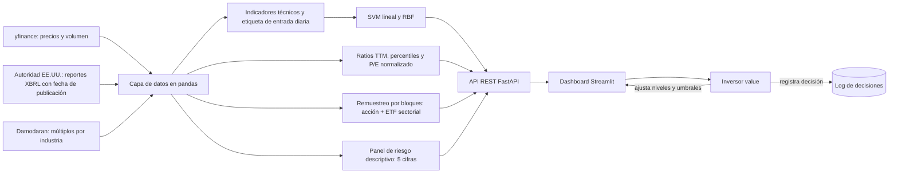

# Punto 2. Ideación

*Asistente bursátil para el inversor value colombiano. Entrega 1, MINE-4101 Ciencia de Datos Aplicada (Universidad de los Andes). Autor: Louis Gualtero.*

Este documento diseña el producto de datos que responde al problema del punto 1 ([01_negocio.md](01_negocio.md)). La evidencia del proceso actual proviene de la entrevista y el formulario de auditoría con el inversor y de la experiencia del propio autor, resumidas sin nombres de terceros en [evidencia_diagnostico.md](evidencia_diagnostico.md). Son dos observaciones (un participante y el autor), por lo que lo que sigue describe un caso de diseño y no una muestra representativa. Los valores del mockup son ilustrativos. El producto solo se diseña en esta entrega: no se construye el modelo final, la API ni el dashboard.

## 2.1 Alcance piloto

El producto se diseña para servir a cualquier industria y en esta entrega se **valida en una sola, consumo defensivo**, con 21 empresas del [ETF sectorial XLP](glosario.md) (criterios: estar en el XLP y tener precios desde 2009) más dos referencias: el [SPY](glosario.md) (el mercado) y el XLP (el sector). La razón de elegir este sector se explica en [01_negocio.md §1.5](01_negocio.md). Para un ticker de una **industria no validada**, el panel se marca de forma visible como "industria no validada": muestra la lectura fundamental y el panel de riesgo descriptivo, y las probabilidades (técnica y de salidas) llevan la advertencia de que el modelo no fue validado en esa industria. Este marcado es un requerimiento obligatorio ([Must](#24-requerimientos), RF11). La extensión a una segunda industria queda como acción próxima en el [punto 7](07_conclusiones.md); el modelo técnico y la simulación se entrenan y validan en cada industria en la entrega 2.

## 2.2 Usuarios

El usuario principal es un inversor intermedio colombiano que compra acciones de EE.UU. [al contado](glosario.md), solo en [posición larga](glosario.md) y con [enfoque value](glosario.md). A lo largo de este documento se le llama Andrés, un nombre ficticio que resume lo observado en la entrevista y en el formulario. Andrés conoce los [múltiplos](glosario.md) ([P/E](glosario.md), [P/B](glosario.md), [ROE](glosario.md), [margen operativo](glosario.md), [deuda/patrimonio](glosario.md)) y el análisis técnico básico ([fuerza relativa a 14 días (RSI)](glosario.md), [medias móviles](glosario.md), [canales de rango máximo-mínimo](glosario.md), volumen). Escoge empresas "a bajo precio" con un [screener](glosario.md), según patrimonio, utilidad y deuda, y exige que el modelo de negocio le guste. Compara los [ratios](glosario.md) de la empresa con su industria y con su propia historia, y busca el punto de entrada con gráficos mensuales de 15 años o semanales de 5 años.

Su rutina es de fin de semana. Hace el análisis, deja un límite de compra o de venta en el bróker y confía en él durante la semana. Su meta es comprar buenas empresas a un precio razonable y salir cuando el precio refleje su escenario. Su frustración es que el trabajo se rehace con cada reporte trimestral: procesar los reportes nuevos le toma de 2 a 3 horas, a veces deja pasar días y la tarea se complica cuando muchos reportes salen seguidos. No tiene un lugar donde anotar lo que concluye, hace la comparación entre fundamentales y gráfico "mentalmente" y resuelve el riesgo con una alarma en el bróker. Dijo que le gustaría tener un lugar donde ver ambos análisis, un ranking por industria de los ratios principales y una lectura técnica de las posiciones bien ubicadas.

El usuario secundario es el propio autor, con un proceso más corto (dos cambios de pantalla como mínimo ideal) y el mismo vacío de registro. Pidió ratios clave, nivel de riesgo y una propuesta de valor resumida en una frase. Ambos coincidieron en que el análisis debe ejecutarse a demanda o con la frecuencia que dicte el usuario, no en continuo, y en que habría que evitar mantener un límite de compra si un reporte cambia el precio de forma negativa.

## 2.3 Proceso actual y dolores

La tabla reconstruye el proceso a partir de las respuestas del participante y del autor. Donde el tiempo no fue declarado se indica, y no se estima.

| Paso | Actor | Herramienta | Tiempo (fuente) | Salida |
|---|---|---|---|---|
| 1. Screening de empresas baratas por patrimonio, utilidad y deuda | Inversor | Screener web (Finviz) | No declarado | Lista corta de candidatas |
| 2. Comparar los ratios (ROE, margen, utilidad por acción, P/E, P/B, deuda, entre otros) con la industria y con la historia de la empresa | Inversor | Herramienta de fundamentales | No declarado | Juicio mental sobre si la empresa está barata |
| 3. Análisis técnico para escoger el punto de entrada (fuerza relativa, volumen, medias móviles, soportes y resistencias, canal de rango; mensual a 15 años o semanal a 5 años) | Inversor | Plataforma de gráficos (TradingView) | No declarado | Nivel de entrada mental |
| 4. Cruce entre fundamentales y gráfico | Inversor | Varias pantallas, de cabeza | 2 a 15 cambios de pantalla por activo (entrevista: 10 a 15; autor: 2 como mínimo) | Ninguna anotación; no hay registro |
| 5. Actualizar el análisis tras un reporte trimestral | Inversor | Las mismas herramientas | 2 a 3 horas, a veces con días de retraso (formulario) | Niveles posiblemente desactualizados |
| 6. Fijar el límite de compra o venta y vigilarlo | Inversor | Alarma o límite en el bróker | No declarado | Orden o alarma, sin cuantificar el riesgo |

La conclusión del diagnóstico es que el inversor actúa como enrutador manual de datos entre herramientas que no se comunican. Los pasos 4 y 5 concentran el costo en tiempo, y los pasos 2 y 6 concentran el riesgo de decidir con información vieja o con una medida de riesgo a ojo. Los dolores, ordenados por el costo que declaró el usuario y por su efecto sobre la decisión, se conectan con la funcionalidad que los atiende y con el KPI del [punto 1](01_negocio.md) que permite verificarlos.

| Prioridad | Dolor (evidencia) | Funcionalidad | KPI |
|---|---|---|---|
| 1 | Latencia tras cada reporte: 2 a 3 horas, a veces días, y los niveles por múltiplo quedan desactualizados | Recálculo automático de los niveles definidos por múltiplo cuando se publica un reporte, diseñado para reportes anuales y trimestrales (precio = múltiplo × utilidad por acción de los últimos 12 meses, según la fecha publicada; el pipeline ya ingiere ambos tipos de reporte en esta entrega) | KPI 3 (latencia ≤ 1 día) y KPI 1 (tiempo) |
| 2 | Fragmentación: 2 a 15 cambios de pantalla y comparación "mental" | Vista única con los 6 niveles, las 3 lecturas y el panel de riesgo descriptivo | KPI 2 (cambios de pantalla) y KPI 1 |
| 3 | Riesgo medido a ojo o con una alarma | Panel de riesgo descriptivo por activo ([volatilidad](glosario.md), [percentil 5](glosario.md), [caída máxima](glosario.md), frecuencia de caídas fuertes y dependencia del sector: [R²](glosario.md) y [ΔR²](glosario.md)) | KPI 5 (confianza) |
| 4 | No hay dónde anotar lo que se concluye | Registro de decisiones con fecha, nivel, lectura y nota | KPI 4 (decisiones documentadas) |
| 5 | No se sabe si el nivel es razonable frente a la historia y la industria | Lectura fundamental comparativa ([percentiles](glosario.md) frente a la historia y la industria, incluyendo el [P/E normalizado](glosario.md)) | KPI 1 y KPI 5 |
| 6 | Timing de entrada solo con gráficos y patrones básicos | Lectura técnica: probabilidad del modelo técnico frente a la [línea base por decil de σ](glosario.md) | KPI 5 (la calidad del score se evalúa con las métricas del [punto 4](04_enfoque_analitico.md), sección 4.4) |

## 2.4 Requerimientos

Los requerimientos se priorizan con MoSCoW (Must, Should, Could, Won't para esta entrega) y cada uno tiene un criterio de verificación.

| ID | Requerimiento funcional | MoSCoW | Verificación |
|---|---|---|---|
| RF1 | Mostrar 3 niveles de entrada (deep value, value, valoración histórica) y 3 de salida (negativo, base, positivo), definidos en precio y en múltiplo en paralelo | Must | Para un ticker, aparecen los 6 niveles con ambas definiciones |
| RF2 | Lectura fundamental comparativa por nivel: múltiplo implícito, percentil frente a la historia propia (P/E sobre la [utilidad por acción de los últimos 12 meses (EPS TTM)](glosario.md)) y percentil frente a su industria, más el percentil del P/E normalizado (precio ÷ promedio de 3 años de utilidad por acción) como lectura principal del "barata frente a su historia"; cuando aplique, lectura de [trampa de valor](glosario.md) según la descomposición de la pregunta P2 (precio frente a utilidades promedio); ROE, margen y deuda como contexto de calidad | Must | Cada fila muestra ambos percentiles con datos ≤ t, incluyendo el P/E normalizado |
| RF3 | Lectura técnica diaria por nivel de entrada: probabilidad del modelo técnico (SVM) frente a la línea base por decil de volatilidad y su incertidumbre | Must | La probabilidad se muestra junto a la línea base y al desempeño histórico del modelo |
| RF4 | Lectura probabilística semanal por nivel de salida: probabilidad y tiempo estimado de alcance mediante simulación por **remuestreo de bloques de semanas históricas** de la acción y su ETF sectorial al mismo tiempo | Must | Cada nivel muestra la probabilidad con su rango de incertidumbre y la fecha de los datos usados |
| RF5 | Recalcular los niveles por múltiplo al aparecer un reporte nuevo (trimestral o anual); esta entrega ya ingiere ambos y construye la utilidad por acción de los últimos 12 meses | Must | La fecha de recálculo menos la fecha del reporte publicado es ≤ 1 día (KPI 3; medición operativa en la entrega 2) |
| RF6 | Panel de riesgo descriptivo con cinco cifras: volatilidad anualizada, percentil 5 del retorno semanal, caída máxima (drawdown), frecuencia de caídas fuertes (semanas con pérdida mayor que dos veces la volatilidad reciente) y dependencia del sector (R² del modelo mercado + sector y ΔR² del sector, calculados como en nb04 §6.1) | Must | Las cinco cifras aparecen para cada ticker del universo piloto |
| RF7 | Permitir que el usuario ajuste sus niveles y umbrales | Should | El usuario edita un nivel y la pantalla se recalcula |
| RF8 | Registro de decisiones con fecha, nivel y nota | Should | Hay una entrada por decisión (KPI 4) |
| RF9 | Escenarios del sector en la simulación (por ejemplo, filtrar bloques de semanas con el ETF a la baja) | Could | El usuario cambia el supuesto del ETF y ve el efecto |
| RF10 | Alertas automáticas, conexión al bróker, gestión de portafolio y screening de todo el mercado | Won't | Fuera del alcance (entrega 2 en adelante) |
| RF11 | Para un ticker de una industria no validada, marcar visiblemente "industria no validada" y advertir que las probabilidades no están validadas en esa industria | Must | Un ticker fuera del universo piloto muestra la marca y las probabilidades con advertencia; la lectura fundamental y el panel de riesgo descriptivo sí se muestran |

| ID | Requerimiento no funcional | MoSCoW | Verificación |
|---|---|---|---|
| RN1 | Explicabilidad: el modelo técnico es un SVM lineal cuyos coeficientes son legibles; el score se presenta como probabilidad, nunca como "compra" o "vende" | Must | Cada score viene con su rango de incertidumbre, línea base y errores históricos |
| RN2 | Sin look-ahead: toda lectura en t usa solo datos ≤ t y la fecha publicada del reporte | Must | Reglas del [punto 4](04_enfoque_analitico.md), sección 4.3 |
| RN3 | Latencia de actualización ≤ 1 día tras un reporte | Must | KPI 3 |
| RN4 | Datos gratuitos (yfinance, autoridad de EE.UU. y Damodaran) y reproducibles mediante instantáneas con fecha | Must | Todo corre sin claves de pago |
| RN5 | Disclaimer visible: "No es asesoría de inversión" | Must | Presente en cada pantalla |
| RN6 | Ejecución a demanda o con la frecuencia que fije el usuario, no en tiempo real | Should | Coincide con lo pedido en la entrevista |
| RN7 | Respuesta de la API para un ticker en un tiempo interactivo | Could | Se medirá en la fase de construcción |

## 2.5 Componentes analíticos y tecnológicos

El producto se compone de cuatro módulos analíticos y tres tecnológicos. Cada módulo se justifica por la lectura o el requerimiento que atiende.

| Tipo | Componente | Función | Justificación | Requerimientos |
|---|---|---|---|---|
| Analítico (ML) | SVM lineal (coeficientes legibles) y SVM RBF como comparación, con la magnitud de retornos (`|r_t|`, [volatilidades de 20 y 252 sesiones](glosario.md)) y los [indicadores técnicos](glosario.md) que la pregunta P4 justifique; solo usa información de precios | Estima la probabilidad diaria de que el precio toque el nivel de entrada en N [días hábiles](glosario.md) antes de escaparse hacia arriba | El SVM lineal permite explicar la contribución de cada variable; el RBF mide si la no linealidad aporta | RF3, RN1 |
| Analítico | Percentiles sobre historia propia e industria, incluido el **P/E normalizado** (precio ÷ promedio de 3 años de utilidad por acción) y la descomposición del cambio del P/E normalizado en precio y utilidades promedio | Ubica cada nivel frente a la historia y la industria y marca "trampa de valor" cuando el "barata" se explica por la caída de la utilidad promedio y no por el precio | Responde "¿es razonable este nivel?" y "¿el 'barata' es temporal?" (P2 y P3 del [punto 4](04_enfoque_analitico.md)) | RF2 |
| Analítico | Simulación por **remuestreo de bloques de semanas** de la acción y su ETF sectorial al mismo tiempo | Probabilidad y tiempo estimados de alcanzar cada nivel de salida | Conserva la relación con el sector y el agrupamiento de la turbulencia sin suponer una forma paramétrica de los retornos | RF4, RF9 |
| Analítico | Panel de riesgo descriptivo (5 cifras directas) | Cuantifica el riesgo que hoy se mide a ojo con medidas interpretables | Volatilidad anualizada, percentil 5, caída máxima, frecuencia de caídas fuertes y dependencia del sector (R² del modelo mercado + sector y ΔR² del sector; cálculo en nb04 §6.1) | RF6 |
| Tecnológico | Capa de datos: yfinance, autoridad de EE.UU. (SEC EDGAR) y Damodaran, en pandas en memoria | Lee las fuentes y reconstruye el panel con la fecha publicada de cada reporte | No es un proyecto de ingeniería de datos; solo se guarda una instantánea con fecha para reproducir el análisis | RN2, RN4 |
| Tecnológico | API REST (FastAPI) | Endpoints de niveles, análisis fundamental, probabilidad y riesgo | Separa el cálculo de la presentación y permite probar cada módulo | RF1 a RF6, RF8, RF11 |
| Tecnológico | Dashboard (Streamlit) | Muestra la vista única y consume la API | Es rápido de construir y suficiente para la validación con el usuario | RF1 a RF8, RF11 |

### Un nivel en dólares expresado en "k volatilidades" (ejemplo numérico)

Para que el modelo técnico pueda comparar un nivel entre acciones distintas, el nivel se traduce a cuántas volatilidades diarias por debajo del precio actual queda, en N días hábiles. La fórmula es `k = ln(P_t / nivel) / (σ_diaria · √N)`, donde `P_t` es el precio hoy, `σ_diaria` es la volatilidad diaria reciente de la acción y `√N` lleva esa volatilidad al horizonte de N días. **Ejemplo numérico (ilustrativo).** Supongamos `P_t = 100`, nivel objetivo de entrada `92` (una caída deseada del 8 %), `σ_diaria = 1,5 %` y `N = 60` días hábiles. Entonces `k = ln(100/92) / (0,015 · √60) ≈ 0,0834 / 0,1162 ≈ 0,72`. En palabras simples: ese nivel está a ≈ 0,72 volatilidades diarias (escaladas al horizonte de 60 días) bajo el precio. Si para otra empresa el mismo precio en dólares equivaliera a 2 volatilidades, el modelo entiende que es un nivel "mucho más lejano" aunque la distancia porcentual sea similar.

El flujo de datos se resume así:

El recálculo por reporte nuevo entra por la rama de la autoridad de EE.UU.: cambios en la utilidad por acción de los últimos 12 meses se propagan a los niveles por múltiplo, a los percentiles y a la simulación sin intervención del usuario.

## 2.6 Cadencia de cada lectura

- **Técnica (SVM):** se actualiza **cada día**, porque la volatilidad y los indicadores técnicos cambian a diario.
- **Fundamental:** se actualiza **con cada reporte nuevo** (trimestral o anual) de la autoridad de EE.UU., porque los ratios cambian solo cuando se publica una nueva cifra.
- **Probabilística (simulación) y panel de riesgo:** se actualizan **cada semana**, porque el horizonte del inversor y la frecuencia natural de los retornos para esta rama son semanales.

## 2.7 Mockup

El wireframe muestra, para un ticker, el encabezado (ticker, precio y fecha del último reporte publicado); una **franja "Cómo leer esta pantalla"** con 7 definiciones de una línea (P/E, P/B, percentil, industria piloto, lectura técnica, lectura probabilística y línea base); la tabla de los seis niveles con el precio, el **% vs. precio actual**, el P/E (TTM) y el P/B en columnas separadas, el **percentil del P/E en la historia y en la industria** y, al lado, las dos lecturas: la **técnica** con la probabilidad del SVM, su rango de incertidumbre y la línea base por decil de volatilidad, marcada "se entrena en la entrega 2", y la **probabilística** con la probabilidad de alcanzar la salida y su rango por simulación. Un **recuadro de notas** aparte guarda la lectura "¿suele ser temporal?" de las entradas baratas. El recuadro de desempeño histórico del modelo ([AUC](glosario.md), [Brier](glosario.md) y [calibración](glosario.md)) queda marcado "se calcula en la entrega 2". El panel de riesgo descriptivo trae las cinco cifras (incluidos [R²](glosario.md) y [ΔR²](glosario.md) del ticker de ejemplo con las cifras reales de nb04 §6.1) y el gráfico de precio con los seis niveles marca el precio actual con una **frase descriptiva** ("entre $67 y $76"), sin veredicto. La etiqueta de entrada usa N = 60 días hábiles. Los valores de niveles y probabilidades son ilustrativos y están marcados como tales en la imagen; las cifras del panel de riesgo del ticker de ejemplo salen de las [instantáneas](glosario.md) de `data/snapshots/`. Se genera con `scripts/mockup.py`.

![Mockup del dashboard (v2, valores ilustrativos). La franja "Cómo leer esta pantalla" define los 7 términos clave en una línea; la tabla separa P/E y P/B, agrega la columna "% vs. precio actual" y rotula la columna técnica "modelo SVM, se entrena en la entrega 2"; las notas 1 a 3 bajo la tabla llevan la lectura "¿suele ser temporal?" de la fundamental para las tres entradas; el panel de riesgo descriptivo tiene 5 filas espaciadas con una línea de ayuda cada una; la marca del precio actual sobre el gráfico lleva una frase descriptiva ("entre Valoración histórica $67 y Salida negativo $76"), sin veredicto. La versión que vio el stakeholder (v1) se conserva en `assets/mockup_v1.png`.](../../entregables/entrega_1/assets/mockup.png)

La tabla relaciona cada elemento del mockup con los requerimientos de la sección 2.4, de modo que ningún requerimiento Must queda sin un elemento que lo represente y ningún elemento queda sin requerimiento. Los botones son de maqueta: no hacen nada en el wireframe.

| Elemento del mockup | Requerimiento |
|---|---|
| Encabezado con ticker, precio y fecha publicada del último reporte | RF5, RN2, RN3 |
| Filas de los 6 niveles con precio y múltiplo implícito, y marcador de divergencia precio frente a múltiplo | RF1 |
| Columnas de percentil histórico y de la industria (incluido el P/E normalizado) | RF2 |
| Columna del SVM con intervalo y línea base por decil de volatilidad al lado | RF3, RN1 |
| Recuadro "Desempeño histórico" (AUC, Brier y calibración) | RF3, RN1 |
| Columna de probabilidad por simulación (bloques de semanas de la acción y el ETF) | RF4 |
| Panel de riesgo descriptivo (5 cifras) | RF6 |
| Gráfico de precio con los 6 niveles | RF1 |
| Botón "Editar nivel" | RF7 |
| Botón "Registrar decisión" | RF8 |
| Marca "industria no validada" (para tickers fuera del piloto) | RF11 |
| Disclaimer "No es asesoría de inversión" | RN5 |
| Sin elemento en el wireframe: RF9 (Could, escenarios del sector), RN4 (datos gratuitos) y RN6 (ejecución a demanda), que son propiedades del sistema y no de la pantalla | RF9, RN4, RN6 |

## 2.8 Principios de diseño

Primero, el usuario ajusta sus niveles y umbrales. La literatura sobre aversión al algoritmo muestra que las personas pierden confianza en un modelo después de verlo equivocarse, pero la recuperan cuando pueden modificar su resultado, aunque sea un poco (Dietvorst et al., 2015 y 2018). Por eso los seis niveles son del usuario y el modelo solo les asigna probabilidades (RF7). Segundo, el score se presenta como una probabilidad acompañada de su incertidumbre, de su línea base y de su desempeño histórico, incluidos los errores, y nunca como "compra" o "vende". El uso de ayudas automatizadas lleva a complacencia y a sesgo de automatización cuando el usuario delega el juicio (Parasuraman & Manzey, 2010), y una probabilidad con su contexto invita a contrastar y no a obedecer (RN1). Esto se pondrá a prueba en la sesión de validación, con la pregunta sobre si el usuario confiaría más al ver la línea base y los errores históricos.

## 2.9 Validación con el stakeholder

El 2026-10-18 se envió al inversor, de forma asíncrona por mensajería, el mockup v1 ([`assets/mockup_v1.png`](../../entregables/entrega_1/assets/mockup_v1.png)) y el formulario de [guion_validacion.md](guion_validacion.md). El participante no respondió el formulario y entregó **feedback libre** con 14 observaciones, que se agrupan en cinco hallazgos (H1 a H5) en [validacion_stakeholder.md](validacion_stakeholder.md). Tres de ellos se aplicaron en el **mockup v2** ([`assets/mockup.png`](../../entregables/entrega_1/assets/mockup.png)): una franja "Cómo leer esta pantalla" con 7 definiciones de una línea (H1), P/E y P/B en columnas separadas con las notas de la fundamental movidas aparte y un panel de riesgo con más espacio (H2), y una columna "% vs. precio actual" en cada nivel (H3). El veredicto que pedía el inversor (H4) no se incorpora porque choca con RN1 y con la regla de no recomendar; el mockup navegable y la línea base de los KPI 1, 2 y 5 (H5) quedan como acciones próximas en el [punto 7](07_conclusiones.md) §7.4.

## Referencias

- Dietvorst, B. J., Simmons, J. P., y Massey, C. (2015). Algorithm aversion: people erroneously avoid algorithms after seeing them err. *Journal of Experimental Psychology: General*, 144(1), 114-126. https://doi.org/10.1037/xge0000033
- Dietvorst, B. J., Simmons, J. P., y Massey, C. (2018). Overcoming algorithm aversion: people will use imperfect algorithms if they can (even slightly) modify them. *Management Science*, 64(3), 1155-1170. https://doi.org/10.1287/mnsc.2016.2643
- Parasuraman, R., y Manzey, D. (2010). Complacency and bias in human use of automation: an attentional integration. *Human Factors*, 52(3), 381-410. https://doi.org/10.1177/0018720810376055
