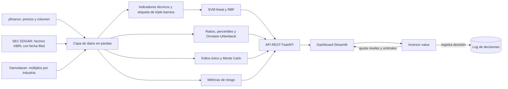

# Punto 2. Ideación

*Asistente bursátil para el inversor value colombiano. Entrega 1, MINE-4101 Ciencia de Datos Aplicada (Universidad de los Andes). Autor: Louis Gualtero.*

Este documento diseña el producto de datos que responde al problema del punto 1 ([01_negocio.md](01_negocio.md)). La evidencia del proceso actual proviene de la entrevista y el formulario de auditoría con el inversor y de la experiencia del propio autor, registradas en `docs/research/Diseño de Asistente Bursátil.txt`. Son dos observaciones (un participante y el autor), por lo que lo que sigue describe un caso de diseño y no una muestra representativa. Los valores del mockup son ilustrativos. El producto solo se diseña en esta entrega: no se construye el SVM final, la API ni el dashboard.

## 2.1 Usuarios

El usuario principal es un inversor intermedio colombiano que compra acciones de EE.UU. en contado, solo en posición larga y con enfoque value. A lo largo de este documento se le llama Andrés, un nombre ficticio que resume lo observado en la entrevista y en el formulario. Andrés conoce los múltiplos (P/E, P/B, FCF yield, ROIC, ROE) y el análisis técnico básico (RSI, medias móviles, canales de Donchian, volumen). Escoge empresas "a bajo precio" con un screener, según patrimonio, utilidad y deuda, y exige que el modelo de negocio le guste. Compara los ratios de la empresa con su industria y con su propia historia, y busca el punto de entrada con gráficos mensuales de 15 años o semanales de 5 años.

Su rutina es de fin de semana. Hace el análisis, deja un límite de compra o de venta en el bróker y confía en él durante la semana. Su meta es comprar buenas empresas a un precio razonable y salir cuando el precio refleje su escenario. Su frustración es que el trabajo se rehace con cada reporte trimestral. Procesar los reportes nuevos le toma de 2 a 3 horas, a veces deja pasar días y la tarea se complica cuando muchos reportes salen seguidos. No tiene un lugar donde anotar lo que concluye, hace la comparación entre fundamentales y gráfico "mentalmente" y resuelve el riesgo con una alarma en el bróker. Dijo que le gustaría tener un lugar donde ver ambos análisis, un ranking por industria de los ratios principales y una lectura técnica de las posiciones bien ubicadas.

El usuario secundario es el propio autor, con un proceso más corto (dos cambios de pantalla como mínimo ideal) y el mismo vacío de registro. Pidió ratios clave, nivel de riesgo y una propuesta de valor resumida en una frase. Ambos coincidieron en que el análisis debe ejecutarse a demanda o con la frecuencia que dicte el usuario, no en continuo, y en que habría que evitar mantener un límite de compra si un reporte cambia el precio de forma negativa.

## 2.2 Proceso actual

La tabla reconstruye el proceso a partir de las respuestas del participante y del autor. Donde el tiempo no fue declarado se indica, y no se estima.

| Paso | Actor | Herramienta | Tiempo (fuente) | Salida |
|---|---|---|---|---|
| 1. Screening de empresas baratas por patrimonio, utilidad y deuda | Inversor | Screener web (Finviz) | No declarado | Lista corta de candidatas |
| 2. Comparar los ratios (margen bruto, ROIC, ROE, P/E, FCF yield, EPS, CAGR, capex/ventas, entre otros) con la industria y con la historia de la empresa | Inversor | Herramienta de fundamentales | No declarado | Juicio mental sobre si la empresa está barata |
| 3. Análisis técnico para escoger el punto de entrada (RSI, volumen, SMA, EMA, soportes y resistencias, Donchian; mensual a 15 años o semanal a 5 años) | Inversor | Plataforma de gráficos (TradingView) | No declarado | Nivel de entrada mental |
| 4. Cruce entre fundamentales y gráfico | Inversor | Varias pantallas, de cabeza | 2 a 15 cambios de pantalla por activo (entrevista: 10 a 15; autor: 2 como mínimo) | Ninguna anotación; no hay registro |
| 5. Actualizar el análisis tras un reporte trimestral | Inversor | Las mismas herramientas | 2 a 3 horas, a veces con días de retraso (formulario) | Niveles posiblemente desactualizados |
| 6. Fijar el límite de compra o venta y vigilarlo | Inversor | Alarma o límite en el bróker | No declarado | Orden o alarma, sin cuantificar el riesgo |

La conclusión de este diagnóstico es que el inversor actúa como enrutador manual de datos entre herramientas que no se comunican. Los pasos 4 y 5 concentran el costo en tiempo, y los pasos 2 y 6 concentran el riesgo de decidir con información vieja o con una medida de riesgo a ojo.

## 2.3 Dolores y funcionalidades

Los dolores se priorizan por el costo que declaró el usuario y por su efecto sobre la decisión. La matriz conecta cada dolor con la funcionalidad que lo atiende y con el KPI de [01_negocio.md](01_negocio.md) (sección 1.6) que permite verificarlo.

| Prioridad | Dolor (evidencia) | Funcionalidad | KPI |
|---|---|---|---|
| 1 | Latencia tras cada reporte: 2 a 3 horas, a veces días, y los niveles por múltiplo quedan desactualizados | Recálculo automático de los niveles definidos por múltiplo cuando EDGAR publica un reporte (precio = múltiplo × EPS, según `filed`), con la divergencia entre el nivel en precio y en múltiplo como señal | KPI 3 (latencia ≤ 1 día) y KPI 1 (tiempo) |
| 2 | Fragmentación: 2 a 15 cambios de pantalla y comparación "mental" | Vista única con los 6 niveles, las 3 lecturas y el panel de riesgo | KPI 2 (cambios de pantalla) y KPI 1 |
| 3 | Riesgo medido a ojo o con una alarma | Panel de riesgo por activo (volatilidad, VaR/ES, β, drawdown, Merton PD) | KPI 5 (confianza) |
| 4 | No hay dónde anotar lo que se concluye | Registro de decisiones con fecha, nivel, lectura y nota | KPI 4 (decisiones documentadas) |
| 5 | No se sabe si el nivel es razonable frente a la historia y la industria | Lectura fundamental comparativa (percentil en la historia y en la industria) | KPI 1 y KPI 5 |
| 6 | Timing de entrada solo con gráficos y patrones básicos | Lectura técnica: P(SVM) frente a la línea base GBM | KPI 5 (la calidad del score se evalúa con las métricas de la sección 4.4 de [04_enfoque_analitico.md](04_enfoque_analitico.md)) |

## 2.4 Requerimientos

Los requerimientos se priorizan con MoSCoW (Must, Should, Could, Won't para esta entrega) y cada uno tiene un criterio de verificación. Los identificadores se citan en la sección 2.6 para mostrar la correspondencia con el mockup.

| ID | Requerimiento funcional | MoSCoW | Verificación |
|---|---|---|---|
| RF1 | Mostrar 3 niveles de entrada (deep value, value, valoración histórica) y 3 de salida (negativo, base, positivo), definidos en precio y en múltiplo en paralelo | Must | Para un ticker, aparecen los 6 niveles con ambas definiciones |
| RF2 | Lectura fundamental comparativa por nivel: múltiplo implícito, percentil en la historia propia y percentil en la industria | Must | Cada fila muestra ambos percentiles, calculados con datos ≤ t |
| RF3 | Lectura técnica por nivel de entrada: P(SVM) con la línea base GBM al lado y su incertidumbre | Must | La probabilidad se muestra junto a la línea base y al desempeño histórico del modelo |
| RF4 | Lectura probabilística por nivel: P(Monte Carlo) calculada con y sin el componente del sector (`simular_indice_unico` con `con_sector` verdadero y falso) | Must | Cada nivel muestra ambas probabilidades; su diferencia indica cuánto cambia el resultado al incluir el sector (no es una descomposición aditiva) |
| RF5 | Recalcular los niveles por múltiplo al aparecer un reporte nuevo en EDGAR | Must | La fecha de recálculo menos la fecha `filed` es ≤ 1 día (KPI 3) |
| RF6 | Panel de riesgo con volatilidad, VaR/ES, β, drawdown y Merton PD | Must | Las cinco métricas aparecen para cada ticker del universo |
| RF7 | Permitir que el usuario ajuste sus niveles y umbrales | Should | El usuario edita un nivel y la pantalla se recalcula |
| RF8 | Registro de decisiones con fecha, nivel y nota | Should | Hay una entrada por decisión (KPI 4) |
| RF9 | Escenarios del sector en el Monte Carlo (por ejemplo, el ETF sectorial cae o sube) | Could | El usuario cambia el supuesto del ETF y ve el efecto |
| RF10 | Alertas automáticas, conexión al bróker, gestión de portafolio y screening de todo el mercado | Won't | Fuera del alcance (spec, sección 1) |

| ID | Requerimiento no funcional | MoSCoW | Verificación |
|---|---|---|---|
| RN1 | Explicabilidad: el modelo lineal expone sus coeficientes y SHAP; el score se presenta como probabilidad, nunca como "compra" o "vende" | Must | Cada score viene con línea base, incertidumbre y errores históricos |
| RN2 | Sin look-ahead: toda lectura en t usa solo datos ≤ t y la fecha `filed` | Must | Pruebas con series sintéticas y la regla de la sección 4.3 |
| RN3 | Latencia de actualización ≤ 1 día tras un reporte | Must | KPI 3 |
| RN4 | Datos gratuitos (yfinance, EDGAR, Damodaran) y reproducibles mediante instantáneas con fecha | Must | Todo corre sin claves de pago |
| RN5 | Disclaimer visible: "No es asesoría de inversión" | Must | Presente en cada pantalla |
| RN6 | Ejecución a demanda o con la frecuencia que fije el usuario, no en tiempo real | Should | Coincide con lo pedido en la entrevista |
| RN7 | Respuesta de la API para un ticker en un tiempo interactivo (sin umbral fijado en esta entrega; se define al construirla) | Could | Se medirá en la fase de construcción |

## 2.5 Componentes analíticos y tecnológicos

El producto se compone de cuatro módulos analíticos y tres tecnológicos. Cada módulo se justifica por la lectura o el requerimiento que atiende.

| Tipo | Componente | Función | Justificación | Requerimientos |
|---|---|---|---|---|
| Analítico (ML) | SVM lineal, comparado con un SVM RBF, solo con indicadores técnicos | Estima P(el precio toca el nivel de entrada en N semanas antes de escaparse hacia arriba), con la etiqueta de triple barrera solo-largo | El modelo lineal permite explicar los coeficientes directamente; el RBF mide si la no linealidad aporta | RF3, RN1 |
| Analítico | Percentiles y proceso de Ornstein-Uhlenbeck | Ubica el múltiplo implícito de cada nivel en la historia de la empresa y en la industria (pares y Damodaran) | Responde si el nivel es razonable para la empresa (HF1, HF2) | RF2 |
| Analítico | Monte Carlo con modelo de índice único, r = α + β·r_ETF + ε (GBM o GARCH-t) | Probabilidad y tiempo de alcanzar cada nivel, con y sin el componente del sector | Es la línea base del SVM y la lectura de las salidas (HP0, HP3) | RF4, RF9 |
| Analítico | Métricas de riesgo | Volatilidad (histórica, EWMA, GARCH), VaR y ES, β, drawdown, Merton PD | Cuantifica el riesgo que hoy se mide a ojo | RF6 |
| Tecnológico | Capa de datos: yfinance, EDGAR y Damodaran, en pandas en memoria | Lee las fuentes y reconstruye el panel con la fecha `filed` | No es un proyecto de ingeniería de datos; solo se guarda una instantánea con fecha para reproducir el análisis | RN2, RN4 |
| Tecnológico | API REST (FastAPI) | Endpoints de niveles, análisis fundamental, probabilidad y riesgo | Separa el cálculo de la presentación y permite probar cada módulo | RF1 a RF6, RF8 |
| Tecnológico | Dashboard (Streamlit) | Muestra la vista única y consume la API | Es rápido de construir y suficiente para la validación con el usuario | RF1 a RF8 |

El flujo de datos es el siguiente.

El recálculo por reporte nuevo entra por la rama de EDGAR: el cambio del EPS se propaga a los niveles definidos por múltiplo, a los percentiles y al Monte Carlo sin intervención del usuario.

## 2.6 Diseño de la solución y mockup

### 2.6.1 Los seis niveles

El usuario define seis niveles, cada uno en precio y en múltiplo en paralelo. Los tres de entrada (deep value, value y valoración histórica) están por debajo o cerca del precio actual. Los tres de salida (escenario negativo o conservador, base y positivo) están todos por encima, porque el usuario espera que la acción suba incluso en su escenario negativo. Los niveles definidos por múltiplo se recalculan cuando EDGAR publica un reporte nuevo: el precio es el múltiplo por el EPS vigente según la fecha `filed`, lo que elimina la latencia posterior a cada reporte. Cuando el nivel en precio y el nivel en múltiplo divergen, la divergencia se muestra como una señal para que el usuario decida cuál conservar.

### 2.6.2 Las tres lecturas por nivel

La lectura fundamental comparativa responde si el nivel es razonable para esta empresa. Para cada nivel, el múltiplo implícito se ubica como percentil en la historia propia (calculada con EDGAR) y en la industria (pares y Damodaran), y se complementa con el proceso de Ornstein-Uhlenbeck sobre el múltiplo propio y el relativo a la industria. Aplica a entradas y salidas.

La lectura técnica responde si el usuario compra ya o espera. Un SVM estima la probabilidad de que el precio toque el nivel de entrada en N semanas antes de escaparse hacia arriba, con una etiqueta de triple barrera solo-largo cuyas barreras son múltiplos de σ. El SVM solo usa indicadores técnicos, de modo que la lectura fundamental y la técnica sean independientes y el usuario pueda contrastarlas. Aplica a los niveles de entrada.

La lectura probabilística responde qué tan probable es alcanzar el nivel y en cuánto tiempo. Un Monte Carlo con el modelo de índice único, r = α + β·r_ETF + ε, se simula con y sin el componente del sector (`simular_indice_unico` con `con_sector` verdadero y falso), de modo que el usuario compara las dos probabilidades y ve cuánto cambia el resultado por el sector, y permite escenarios del sector. No es una descomposición aditiva: la diferencia entre ambas no se reparte entre sector y empresa. Aplica a las salidas y, en las entradas, sirve como línea base del SVM.

### 2.6.3 Panel de riesgo

Cada activo trae su volatilidad anualizada (histórica, EWMA y GARCH(1,1)), el VaR histórico y paramétrico al 95 % y 99 % junto con el Expected Shortfall, la β y la α frente a SPY y al ETF sectorial con su parte sistemática e idiosincrática, el máximo drawdown y el Sharpe por activo, y la distancia al default de Merton (PD = N(−d₂)).

### 2.6.4 Principios de diseño

Primero, el usuario ajusta sus niveles y umbrales. La literatura sobre aversión al algoritmo muestra que las personas pierden confianza en un modelo después de verlo equivocarse, pero la recuperan cuando pueden modificar su resultado, aunque sea un poco (Dietvorst et al., 2015 y 2018). Por eso los seis niveles son del usuario y el modelo solo les asigna probabilidades (RF7).

Segundo, el score se presenta como una probabilidad acompañada de su incertidumbre, de su línea base y de su desempeño histórico, incluidos los errores, y nunca como "compra" o "vende". El uso de ayudas automatizadas lleva a complacencia y a sesgo de automatización cuando el usuario delega el juicio (Parasuraman & Manzey, 2010), y una probabilidad con su contexto invita a contrastar y no a obedecer (RN1). Esto se pondrá a prueba en la sesión de validación, con la pregunta sobre si el usuario confiaría más al ver la línea base y los errores históricos.

### 2.6.5 Mockup

El wireframe muestra, para un ticker, el encabezado (ticker, precio y fecha del último reporte `filed`), la tabla de los seis niveles con sus tres lecturas (percentiles con la etiqueta "p", P(SVM) con su intervalo y la línea base GBM, P(Monte Carlo) con y sin el componente del sector y un marcador cuando el nivel en precio y en múltiplo divergen), un recuadro de desempeño histórico del modelo (AUC y Brier del SVM y del GBM, y porcentaje de errores), el panel de riesgo, el gráfico de precio con los seis niveles, una línea con los indicadores que más pesaron, los botones "Editar nivel" y "Registrar decisión" y el disclaimer. Los valores son ilustrativos y están marcados como tales en la imagen. Se generó con `scripts/mockup.py`.

La tabla relaciona cada elemento del mockup con los requerimientos de la sección 2.4, de modo que ningún requerimiento Must queda sin un elemento que lo represente y ningún elemento queda sin requerimiento. Los botones son de maqueta: no hacen nada en el wireframe.

| Elemento del mockup | Requerimiento |
|---|---|
| Encabezado con ticker, precio y fecha `filed`; nota de recálculo tras el reporte | RF5, RN2, RN3 |
| Filas de los 6 niveles con precio y múltiplo implícito, y marcador de divergencia precio frente a múltiplo | RF1 |
| Columnas de percentil histórico y de la industria (p8, p15, ...) | RF2 |
| Columna P(SVM) con intervalo y línea base GBM al lado | RF3, RN1 |
| Recuadro "Desempeño histórico" (AUC y Brier del SVM y del GBM, % de errores) | RF3, RN1 |
| Línea "Indicadores que más pesaron" | RN1 |
| Columna P(Monte Carlo) con y sin componente del sector | RF4 |
| Panel de riesgo (volatilidad, VaR histórico y paramétrico, ES, β y α, R², Sharpe, drawdown, Merton PD) | RF6 |
| Gráfico de precio con los 6 niveles | RF1 |
| Botón "Editar nivel" | RF7 |
| Botón "Registrar decisión" | RF8 |
| Disclaimer "No es asesoría de inversión" | RN5 |
| Sin elemento en el wireframe: RF9 (Could, escenarios del sector), RN4 (datos gratuitos) y RN6 (ejecución a demanda), que son propiedades del sistema y no de la pantalla | RF9, RN4, RN6 |

## 2.7 Validación con el stakeholder

Esta sección se llena después de la sesión con el stakeholder, que realiza el autor con el guion de [guion_validacion.md](guion_validacion.md) (15 a 20 minutos: tareas sobre el mockup, preguntas de claridad, confianza y explicabilidad en escala de 1 a 5, y cambios que pediría). Al momento de escribir este documento la sesión no se ha realizado, por lo que no se reportan respuestas, puntajes ni cambios.

El registro con la fecha, el participante anonimizado, las respuestas y los cambios derivados se documenta en [validacion_stakeholder.md](validacion_stakeholder.md). Tras la sesión se agregarán aquí un resumen con fecha, qué entendió el participante, qué cambiaría, su nivel de confianza y los cambios concretos hechos al diseño (con los requerimientos de la sección 2.4 que se modifiquen), de modo que el feedback tenga una consecuencia verificable. El puntaje de claridad, confianza y explicabilidad alimenta además el KPI 5 del punto 1.

## Referencias

- Dietvorst, B. J., Simmons, J. P., y Massey, C. (2015). Algorithm aversion: people erroneously avoid algorithms after seeing them err. *Journal of Experimental Psychology: General*, 144(1), 114-126. https://doi.org/10.1037/xge0000033
- Dietvorst, B. J., Simmons, J. P., y Massey, C. (2018). Overcoming algorithm aversion: people will use imperfect algorithms if they can (even slightly) modify them. *Management Science*, 64(3), 1155-1170. https://doi.org/10.1287/mnsc.2016.2643
- Parasuraman, R., y Manzey, D. (2010). Complacency and bias in human use of automation: an attentional integration. *Human Factors*, 52(3), 381-410. https://doi.org/10.1177/0018720810376055
