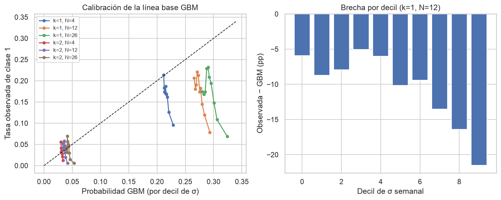
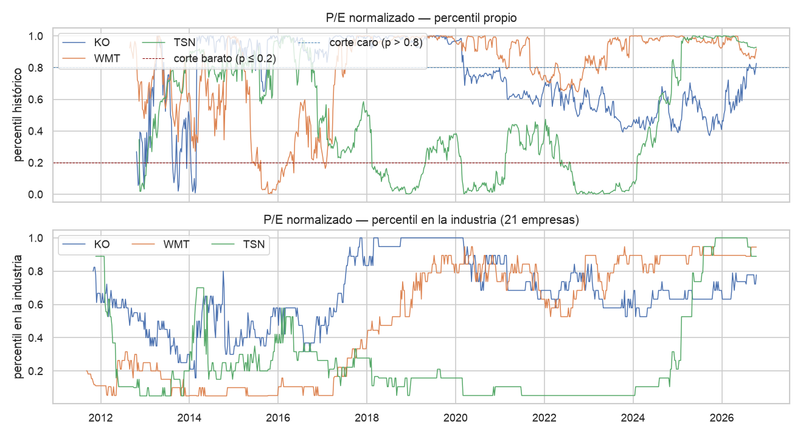

# 7. Conclusiones e insights

Todas las cifras de este documento salen de celdas ejecutadas en los notebooks
[02](../../notebooks/02_calidad.ipynb), [03](../../notebooks/03_eda_series.ipynb) y
[04](../../notebooks/04_eda_relaciones.ipynb); cada conclusión indica el notebook y la sección
donde está la celda que la respalda (T4, T7). Todo es asociativo, no causal.

## 7.1 Conclusiones

**C1. La volatilidad se agrupa y las colas son pesadas; un GBM normal de volatilidad constante no
describe el riesgo (HP0 apoyada, HT4 apoyada).** Curtosis en exceso mediana 4.63 y ν mediano 4.15
(ν < 10 en 34 de 34 series); Ljung-Box en r² es significativo en 88.2 % de las series y ARCH-LM en
85.3 %. GARCH(1,1)-t supera a la volatilidad constante fuera de muestra en 28 de 34 series (QLIKE
3.713 frente a 3.883). Fuente: [nb03](../../notebooks/03_eda_series.ipynb), secciones 2–5 y
síntesis HP0. Figura: `vol_ewma_garch.png`.

**C2. La dirección del precio se comporta como caminata aleatoria con deriva (HT0 apoyada), pero la
línea base justa para la etiqueta es un GBM con deriva estimada solo con datos pasados.** ADF no
rechaza la raíz unitaria en 33 de 34 log-precios y la rechaza en los retornos de 34 de 34;
|ρ₁| mediana 0.068; Ljung-Box sobre r es significativo en 50 % de las series pero en 11.8 % sobre
residuos estandarizados de GARCH-t. Con la etiqueta k = 1, N = 12, un GBM con μ = 0 sobreestima la
clase 1 en 9.5 pp (0.178 observada frente a 0.274) y con deriva pasada la brecha es −0.8 pp.
Fuente: [nb03](../../notebooks/03_eda_series.ipynb), secciones 5b y 6; [nb04](../../notebooks/04_eda_relaciones.ipynb),
sección 3 (dos celdas, μ = 0 y con deriva). Figura: `nb04_calibracion_gbm.png`.

**C3. Los indicadores técnicos, solos, aportan señal débil e inestable (HT2 no concluyente, HT3 no
apoyada).** Con k = 1 y N = 12 las AUC por indicador van de 0.496 a 0.514 y ningún intervalo por
bloques de fechas excluye 0.5 (`vol_rel20` 0.5137, IC 0.486–0.542); la información mutua es ≤ 0.0064.
Los dos primeros componentes del PCA explican 79.4 % de la varianza y su AUC es 0.503 y 0.507. Por
régimen, la AUC de momentum y RSI es 0.497–0.519 en expansión y periodo reciente (≈ 87 % de las
observaciones) y sube a 0.64–0.79 solo en COVID y en la caída de 2022, que son eventos únicos y comunes
a todos los tickers. Fuente: [nb04](../../notebooks/04_eda_relaciones.ipynb), secciones 4, 6 y 9.
Figura: `nb04_auc_por_regimen.png`.

**C4. El sector explica buena parte del retorno de cada acción (HP3 apoyada con matices).** El R²
mediano del modelo de índice único con el ETF sectorial es 0.525 (financieras 0.700, consumo
defensivo 0.495, tecnología 0.387), y las industrias se agrupan solas por correlación de retornos
(ARI 0.898; correlación intra-industria 0.526 frente a 0.261 entre industrias). Fuente:
[nb04](../../notebooks/04_eda_relaciones.ipynb), secciones 7 y 9. Figura: `nb04_hp3_indice_unico.png`.

**C5. Los múltiplos no revierten a su historia como regla general (HF1 no apoyada; HF2 parcial).**
Solo 7 de 29 tickers evaluables muestran reversión del P/E o P/B (ADF con p < 0.05 y vida media
finita; 6 sin META, que depende de un valor atípico) y 10 de 29 con el múltiplo relativo a su industria
(5 de 10 en consumo defensivo, 2 de 10 en financieras). Los mayores descuentos actuales (GIS 0.31,
KHC 0.40, ADBE 0.45) no pasan la prueba de reversión. Fuente: [nb03](../../notebooks/03_eda_series.ipynb),
sección 8; [nb04](../../notebooks/04_eda_relaciones.ipynb), sección 8. Figura: `multiplos_percentil.png`.

**C6. El VaR histórico y el de GARCH-t no están bien calibrados (HP1 parcialmente apoyada).** Las colas
son más pesadas que la normal (VaR 99 % histórico más extremo que el normal en 30 de 30), pero fuera
de muestra (2020+) el VaR 95 % de GARCH-t tiene 7.49 % de excepciones (mediana; Kupiec rechaza en
15 de 30) y el histórico móvil 6.78 % (8 de 30), frente al 5 % esperado. Fuente:
[nb03](../../notebooks/03_eda_series.ipynb), secciones 9 y 9b y síntesis HP1.

**C7. Los datos son aptos para describir riesgo, pero heterogéneos para fundamentales.** Los precios
están limpios (0 nulos, 0 duplicados, 0 semanas faltantes; 73 saltos > 5σ que son movimientos reales).
`utilidad_bruta` falta en 16 de 30 emisores y `capex` en 8; las 10 financieras no tienen utilidad
operativa. Las cifras de EDGAR coinciden en 6 de 6 con el 10-K de AAPL, KO y JPM. Fuente:
[nb02](../../notebooks/02_calidad.ipynb), secciones 1, 3, 4 y 7 (síntesis). Figura: `completitud_edgar.png`.

## 7.2 Insights para el producto (cada uno lleva a una decisión)

| Insight | Decisión de diseño | Fuente |
|---|---|---|
| Con k = 1, N = 12 la clase 1 es 17.1 % (≈ 2 245 ventanas no solapadas); con k = 2 es rara (≈ 4 %) | Etiqueta de triple barrera **k = 1, N = 12** | [nb04](../../notebooks/04_eda_relaciones.ipynb) §2 |
| GARCH-t gana a la volatilidad constante en 28 de 34 series | Simulación con **volatilidad GARCH-t / EWMA e innovaciones t**, no GBM normal; barreras escaladas con σ | [nb03](../../notebooks/03_eda_series.ipynb) §5 |
| El GBM con μ = 0 sobreestima 9.5 pp; con deriva pasada, 0.8 pp | Línea base del SVM: **GBM con deriva ≤ t** y tasa empírica por decil de σ; el μ = 0 solo como referencia | [nb04](../../notebooks/04_eda_relaciones.ipynb) §3 |
| La brecha crece con σ (decil 10: −19.4 pp con μ = 0 y −12.3 pp con deriva) | σ y la tasa base por régimen de volatilidad entran como rasgos | [nb04](../../notebooks/04_eda_relaciones.ipynb) §3 |
| VIF ≥ 10 en `dist_ema20` (55.6) y `dist_sma50` (11.6) | Indicadores retenidos: `rsi14`, `dist_sma20`, `vol_rel20`, `donchian20`, `mom_12_1` | [nb04](../../notebooks/04_eda_relaciones.ipynb) §5 |
| Financieras sin margen bruto, margen operativo ni ROIC (0 % de completitud) | **Set de ratios propio** para financieras (ROE, P/B, margen neto); NaN sin imputar en las demás | [nb02](../../notebooks/02_calidad.ipynb) §3 |
| Sector explica R² 0.525 (financieras 0.700, tecnología 0.387) | La simulación incluye el factor del **ETF sectorial** y reporta la parte idiosincrática en tecnología | [nb04](../../notebooks/04_eda_relaciones.ipynb) §7 |
| Múltiplos revierten en 7 de 29 (HF1) y 10 de 29 (HF2) | Percentil del múltiplo solo como **variable de contexto**, no como señal de reversión | [nb03](../../notebooks/03_eda_series.ipynb) §8; [nb04](../../notebooks/04_eda_relaciones.ipynb) §8 |
| Cobertura VaR 95 % fuera de muestra 7.49 % (GARCH-t) y 6.78 % (histórico) | El riesgo se reporta con **VaR 99 % histórico y advertencia** de subestimación | [nb03](../../notebooks/03_eda_series.ipynb) §9 |

**Qué implica para el SVM (HT1).** El EDA no muestra que los indicadores técnicos, por sí solos,
separen las clases: AUC 0.496–0.514 y sin separación en el PCA. Lo que sí mostró es que la
probabilidad de la etiqueta depende de σ (la tasa observada baja de 20.6 % en el decil 1 de σ a
7.8 % en el decil 10, [nb04](../../notebooks/04_eda_relaciones.ipynb) §3) y del régimen
([nb04](../../notebooks/04_eda_relaciones.ipynb) §6). Por eso el SVM no debe presentarse como
"los indicadores predicen": el resultado honesto a esperar es una mejora pequeña o nula sobre la
línea base justa (GBM con deriva y tasa por decil de σ), y la ganancia, si existe, vendrá de
rasgos de volatilidad o de régimen y de interacciones. HT1 queda **preparada, no probada**: se
decide con AUC y Brier en validación walk-forward, no con este EDA.

## 7.3 Suficiencia y limitaciones de los datos

¿Alcanzan para las hipótesis? **Sí para las de riesgo y de sector** (HP0, HT4, HP3: 34 series
semanales, panel de 27 326 filas de 30 tickers, 2009–2026). **Solo de forma parcial para las de
dirección y valoración** (HT2, HT3, HF1–HF3), donde el resultado es débil o no concluyente.

| Limitación | Cuantificación | Efecto | Fuente |
|---|---|---|---|
| Muestra desde enero de 2009 | La crisis 2008–09 solo entra en su tramo final; "Crisis 2009" tiene ≈ 36 semanas y 76 positivas | Régimen de crisis profunda poco representado | [nb04](../../notebooks/04_eda_relaciones.ipynb) §1 y §6 |
| Pocos eventos de régimen | COVID ≈ 13 semanas; 2022 es un solo ciclo común a todos los tickers | La AUC alta de 0.64–0.79 es indicativa de un evento, no un resultado estable | [nb04](../../notebooks/04_eda_relaciones.ipynb) §6 |
| Sesgo de supervivencia | 30 emisores grandes y vigentes en 2026 | Sobreestima retornos y subestima el riesgo de caída | [nb02](../../notebooks/02_calidad.ipynb) §6 |
| Fundamentales incompletos | Utilidad bruta en 14 de 30 emisores (42.3 %); capex en 22 (65.0 %); GOOGL sin P/E (cobertura de P/E de 10 %) | Los modelos no pueden depender de esos conceptos; se excluye GOOGL de HF1 y HF2 | [nb02](../../notebooks/02_calidad.ipynb) §3 |
| Verificación externa parcial | 3 de 30 emisores contrastados con el 10-K | HF5 no se extrapola a los demás | [nb02](../../notebooks/02_calidad.ipynb) §4 |
| Censura de la etiqueta | 336 observaciones censuradas a 12 semanas (1.23 %); la última semana es parcial | Se excluyen de las etiquetas | [nb02](../../notebooks/02_calidad.ipynb) §6 |
| Dependencia entre observaciones | Ventanas de 12 semanas solapadas; IC por bloques de 4 semanas | Los IC por régimen son más estrechos de lo debido | [nb04](../../notebooks/04_eda_relaciones.ipynb) §6 |
| Un único periodo fuera de muestra para GARCH | 2020+, con el choque de 2020 | La ventaja de GARCH-t (28 de 34) es moderada | [nb03](../../notebooks/03_eda_series.ipynb) §10 |
| Split y dividendos | Correcciones por splits ya aplicadas a EPS y valor en libros; el precio de los múltiplos es sin ajuste por dividendos | Sin riesgo de múltiplos distorsionados por splits | [nb03](../../notebooks/03_eda_series.ipynb) §8 |
| Merton | Deuda de largo plazo como único insumo; resultado débil (HF4) | Solo exploratorio | [nb04](../../notebooks/04_eda_relaciones.ipynb) §10 |

## 7.4 Acciones próximas (priorizadas)

Filtro T6: para cada acción se pregunta "¿el inversor tiene este dato hoy?". Todos los rasgos,
percentiles, parámetros de GARCH y deriva se calculan con datos ≤ t (ventana expansiva y fecha
`filed`); solo la etiqueta mira al futuro.

| # | Acción | Responsable | Criterio de terminado | Filtro T6 |
|---|---|---|---|---|
| 1 | Entrenar el SVM (HT1) con validación walk-forward con purga y embargo (N = 12 semanas) y compararlo con el GBM con deriva ≤ t y la tasa por decil de σ, con AUC y Brier | Louis Gualtero | Tabla de AUC y Brier por pliegue y por régimen, con IC por bloques; se declara si el SVM no mejora la línea base | Rasgos y deriva con datos ≤ t; la etiqueta es lo único que usa el futuro |
| 2 | Añadir rasgos de volatilidad y de régimen **calculados hacia atrás**: σ GARCH-t/EWMA condicional, drawdown acumulado del SPY y su volatilidad reciente | Louis Gualtero | Rasgos con prueba unitaria de no look-ahead (los valores en t no cambian si se trunca la serie después de t) | **Atención:** los regímenes del EDA (COVID, 2022) se definieron ex post con fechas; no se pueden usar como rasgo. Se sustituyen por medidas hacia atrás |
| 3 | Construir el motor Monte Carlo con GARCH-t, innovaciones t y factor del ETF sectorial (HP2) | Louis Gualtero | Probabilidades de +20 %, 0 % y −20 % con parámetros re-estimados con ventana expansiva; cobertura comparada con la tasa observada | Parámetros ajustados con datos ≤ t |
| 4 | Calibrar el VaR reportado: añadir el VaR 99 % histórico y evaluar una ventana más corta o EWMA | Louis Gualtero | Tasa de excepciones fuera de muestra y prueba de Kupiec reportadas por acción | La ventana de VaR usa solo retornos pasados |
| 5 | Incluir los ratios de calidad y valoración solo como contexto (percentil en la industria, ROE, P/B), con la fecha `filed` | Louis Gualtero | Percentiles expansivos; ninguna señal de reversión | Se usa el dato a partir de su fecha de presentación, no del cierre fiscal |
| 6 | Ampliar la muestra para reducir las limitaciones: emisores retirados o deslistados si hay fuente, y GOOGL con el conteo de acciones | Louis Gualtero | Informe de cuántos emisores nuevos se obtienen y su efecto sobre HT3 y la línea base | Solo cambia el universo histórico; el inversor ve el universo vigente |
| 7 | Redactar con los usuarios (stakeholder) la advertencia de incertidumbre que acompaña los niveles de salida | Louis Gualtero | Texto validado con el stakeholder; sin lenguaje de recomendación de compra | No depende de datos futuros |

Ninguna acción depende de un dato que el inversor no tenga el día de la decisión. La acción 6 es
la única que cambia el universo, y se identifica como mejora de la muestra de entrenamiento, no
como entrada del producto en t.
