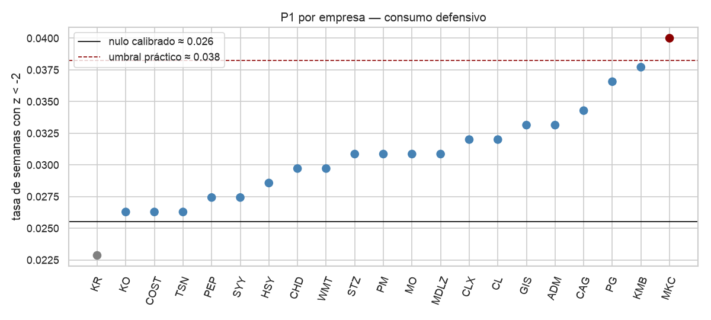
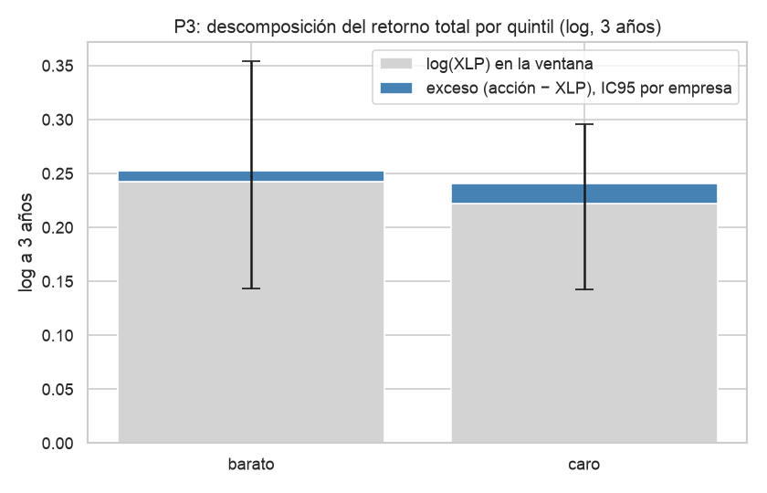
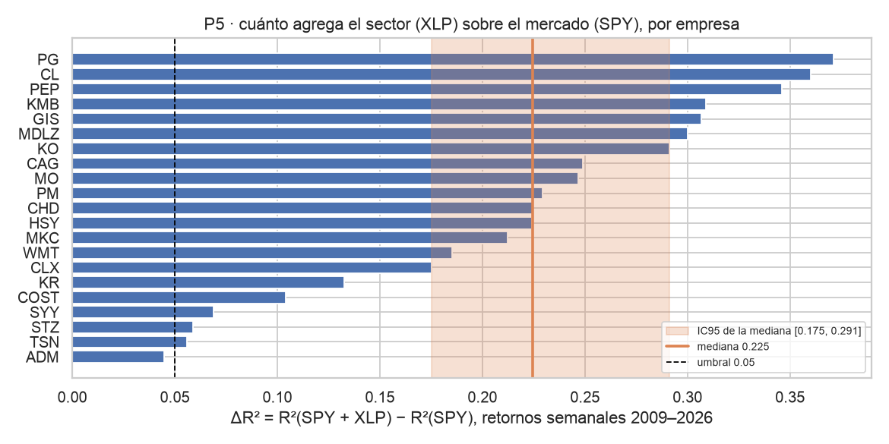

# 7. Conclusiones iniciales

Las cifras de este documento salen de celdas ejecutadas de los notebooks [02](../../notebooks/02_calidad.ipynb), [03](../../notebooks/03_eda_univariado.ipynb) y [04](../../notebooks/04_eda_multivariado.ipynb), con el notebook y la sección de la celda que las genera; también se leen los archivos [`data/resultados/nb03.json`](../../data/resultados/nb03.json), [`nb04.json`](../../data/resultados/nb04.json) y [`nb04_p4.json`](../../data/resultados/nb04_p4.json). Todo se lee como [asociación](glosario.md), nunca como causa; las [decisiones estadísticas](glosario.md) se escriben "se rechaza H0" o "no se rechaza H0", y las [decisiones de negocio](glosario.md) comparan el límite inferior del [IC](glosario.md) con el umbral fijado antes de estimar.

## 7.1 Conclusiones

**C1. Las caídas semanales de más de 2 volatilidades no son más frecuentes que las que daría una [normal medida de la misma forma](glosario.md).** P1 (en consumo defensivo) estima una tasa agregada de 3,08 % semanal, [IC95](glosario.md) por [bloques de fechas](glosario.md) [2,46 %; 3,92 %], frente a un nulo calibrado por simulación de 2,55 % y un umbral de 3,83 %; **no se rechaza H0 y la decisión de negocio es no accionable**. En los subperíodos agregados, 2013–2019 y 2022+ quedan por encima del nulo; el COVID queda con [IC](glosario.md) ancho por tener pocas semanas. Fuente: [nb03 §4](../../notebooks/03_eda_univariado.ipynb) y [`nb03.json`](../../data/resultados/nb03.json) clave `P1`.

**C2. Las acciones "baratas frente a su historia" suben su [P/E normalizado](glosario.md) más que las caras en los 3 años siguientes; la lectura de [trampa de valor](glosario.md) es compatible, no afirmada.** P2 estima una diferencia (barato − caro) de +0,153 anualizada en log del Δlog(P/E normalizado) a 3 años, [IC95](glosario.md) por [empresa](glosario.md) [+0,091; +0,221], umbral 0,03; **se rechaza H0 y la decisión de negocio es accionable**. La descomposición en log por [quintil por fecha](glosario.md) estima dos contribuciones de magnitud similar: precio +0,15 (su IC95 excluye 0) y EPS promedio −0,15 (su IC95 cruza 0); el patrón es **compatible con una trampa de valor**, pero el IC95 del EPS no la afirma. La sensibilidad de composición sin TSN (empresa más frecuente del quintil barato) deja el estimado anualizado en +0,145 con IC95 [+0,083; +0,225]: la decisión principal no cambia. Fuente: [nb04 §2.7 y §2.8](../../notebooks/04_eda_multivariado.ipynb); [`nb04.json`](../../data/resultados/nb04.json) clave `P2`.

**C3. El quintil barato no gana al [XLP](glosario.md) a 3 años dentro del sector.** P3 estima un [exceso sobre el XLP](glosario.md) de +0,006 por año (log), [IC95](glosario.md) por [empresa](glosario.md) [−0,032; +0,049], umbral 0,05; **no se rechaza H0 y la decisión de negocio es no accionable**. La sensibilidad sin TSN deja la decisión en no accionable. Fuente: [nb04 §3.7](../../notebooks/04_eda_multivariado.ipynb); [`nb04.json`](../../data/resultados/nb04.json) clave `P3`.

**C4. Ninguno de los 7 [indicadores técnicos](glosario.md) mejora la [AUC](glosario.md) sobre la [línea base por decil de σ](glosario.md).** P4 estima ΔAUC con [IC95](glosario.md) [Bonferroni](glosario.md) al ≈ 99,3 % (α/7) y [bootstrap por bloques](glosario.md) de 1 fecha trimestral; los 7 IC cruzan 0, incluido el mayor en valor absoluto (`mom_12_1`, ΔAUC −0,018, IC95 [−0,055; +0,019]) y el más estrecho (`vol_rel20`, ΔAUC −0,001, IC95 [−0,011; +0,010]); umbral 0,01. **En los 7 indicadores no se rechaza H0 y la decisión de negocio es no accionable**. Las sensibilidades a bloques de 1, 2 y 4 fechas trimestrales mantienen las 7 decisiones. En consecuencia, `variables_svm = {|r_t|, σ20/σ252, σ252}` (**solo magnitud**, sin indicadores); la [línea base por decil de σ252 diaria](glosario.md) da AUC 0,591 en la prueba, con N = 60 días hábiles. Fuente: [nb04 §5.3](../../notebooks/04_eda_multivariado.ipynb) y [`nb04_p4.json`](../../data/resultados/nb04_p4.json).

**C5. El [XLP](glosario.md) agrega poder explicativo semanal al [SPY](glosario.md).** P5 estima un [ΔR²](glosario.md) mediano por empresa de 0,225, [IC95](glosario.md) por [empresa](glosario.md) [+0,175; +0,291], umbral 0,05; **se rechaza H0 y la decisión de negocio es accionable**. P5 es **confirmatoria**: la industria piloto se eligió, entre otras razones, mirando este ΔR² exploratorio (§7.3), así que su rechazo no es evidencia independiente. Fuente: [nb04 §6](../../notebooks/04_eda_multivariado.ipynb); [`nb04.json`](../../data/resultados/nb04.json) clave `P5`.

**C6. La turbulencia (en magnitud) se agrupa, pero la magnitud exacta es incierta.** En P6 diaria, P(T|T) = 0,305, [IC95](glosario.md) por [bloques de fechas](glosario.md) [0,275; 0,340], umbral 0,30; en P6 semanal, 0,282 con IC95 [0,239; 0,323]. En ambas se rechaza H0 (la diferencia P(T|T) − P(T|calma) tiene un IC95 que excluye 0), pero el IC95 de P(T|T) cruza el umbral: **la decisión de negocio es "efecto real, pero de magnitud incierta"** en las dos frecuencias. Los dos controles de dirección rechazan H0 con un efecto diminuto (diferencia de probabilidad `P(mismo signo | señal) − P(mismo signo | calma)` ≈ −0,02 en diaria y −0,04 en semanal, según [`nb03.json`](../../data/resultados/nb03.json), y [V de Cramér](glosario.md) consistente con esa magnitud en nb03 §5.4); se reporta solo la [decisión estadística](glosario.md) (no llevan decisión de negocio). Fuente: [nb03 §5](../../notebooks/03_eda_univariado.ipynb); [`nb03.json`](../../data/resultados/nb03.json) claves `P6_diaria`, `P6_semanal`, `P6_dir_diaria`, `P6_dir_semanal`.

**C7. La multiplicidad declarada (15 pruebas, 13 con decisión de negocio) no cambia ninguna decisión.** [Holm](glosario.md) al 0,05 sobre las 13 con decisión de negocio deja 4 que siguen rechazando H0 (P2, P5, P6 diaria y P6 semanal), con [p bilateral equivalente](glosario.md) de 0,002 frente a límites de 0,0038 a 0,0050; P1 no rechazaba y tampoco rechaza con Holm. P4 ya se reporta con [Bonferroni](glosario.md) al ≈ 99,3 %. Fuente: [nb04 §8](../../notebooks/04_eda_multivariado.ipynb).

## 7.2 Insights para el producto (cada uno lleva a una decisión)

| Insight (fuente) | Decisión de diseño |
|---|---|
| En consumo defensivo, el quintil barato (por [P/E normalizado](glosario.md)) sube su múltiplo más que el caro en 3 años; la descomposición no permite afirmar si lo normaliza el precio, lo deterioran las utilidades o es [trampa de valor](glosario.md) ([nb04 §2.7 y §2.8](../../notebooks/04_eda_multivariado.ipynb); clave `P2` en [`nb04.json`](../../data/resultados/nb04.json)) | La lectura fundamental del nivel "barata frente a su historia" muestra el **[percentil](glosario.md) propio** del P/E normalizado como lectura principal y el **percentil en la industria** (dentro de las 21 empresas en la misma fecha) como contexto, y agrega la **advertencia descriptiva de posible deterioro de utilidades** ([ROE](glosario.md) y [margen operativo](glosario.md) como contexto). No promete un mejor retorno por comprar barato ([04_enfoque_analitico.md](04_enfoque_analitico.md) §4.3) |
| El quintil barato no gana al [XLP](glosario.md) a 3 años dentro del sector ([nb04 §3.7](../../notebooks/04_eda_multivariado.ipynb)) | El exceso sobre el XLP **no entra como señal** en la lectura fundamental; se usa solo como contexto |
| La [turbulencia](glosario.md) diaria se agrupa (P6: P(T\|T) = 0,305, [IC95](glosario.md) [0,275; 0,340]; efecto real, pero de magnitud incierta) ([nb03 §5](../../notebooks/03_eda_univariado.ipynb); clave `P6_diaria` en [`nb03.json`](../../data/resultados/nb03.json)) | Los niveles se miden en **k · σ252 diaria** y la [etiqueta de entrada](glosario.md) usa un horizonte de **[N = 60 días hábiles](glosario.md)** |
| La turbulencia semanal también se agrupa (P6: P(T\|T) = 0,282, [IC95](glosario.md) [0,239; 0,323]) ([nb03 §5](../../notebooks/03_eda_univariado.ipynb); clave `P6_semanal` en [`nb03.json`](../../data/resultados/nb03.json)) | La [simulación](glosario.md) remuestrea **bloques de semanas** de la acción y del XLP al mismo tiempo, en lugar de semanas sueltas |
| Ninguno de los 7 [indicadores técnicos](glosario.md) mejora la [AUC](glosario.md) sobre la magnitud de la volatilidad ([nb04 §5.3](../../notebooks/04_eda_multivariado.ipynb); [`nb04_p4.json`](../../data/resultados/nb04_p4.json)) | `variables_svm = {|r_t|, σ20/σ252, σ252}` (solo magnitud); el modelo técnico (SVM, [04_enfoque_analitico.md](04_enfoque_analitico.md) §4.3) se evaluará contra la [línea base por decil de σ252 diaria](glosario.md) (AUC 0,591 en la prueba) |
| El XLP agrega un [ΔR²](glosario.md) mediano de 0,225 sobre el SPY, [IC95](glosario.md) [+0,175; +0,291] (P5 confirmatoria, [nb04 §6](../../notebooks/04_eda_multivariado.ipynb); clave `P5` en [`nb04.json`](../../data/resultados/nb04.json)) | La simulación de la lectura probabilística remuestrea semanas de la acción **y del XLP al mismo tiempo** (no solo del SPY) |
| Las [ventanas](glosario.md) de 3 años de la misma empresa se solapan y las 21 empresas comparten choques en una misma fecha ([nb04 §2.4 y §3.4](../../notebooks/04_eda_multivariado.ipynb)) | Las decisiones de P2 y P3 usan **[IC por empresa](glosario.md)** (remuestrea empresas enteras y absorbe el solapamiento); el p-value de Welch se reporta solo con la advertencia de que supone independencia |
| El producto solo se validó en la industria piloto ([01_negocio.md](01_negocio.md) §1.5) | Fuera de consumo defensivo, el panel marca el ticker como **"industria no validada"**: muestra la lectura fundamental y el panel de riesgo, y las probabilidades llevan la advertencia de modelo no validado ([02_ideacion.md](02_ideacion.md)) |

## 7.3 Suficiencia y limitaciones

**Suficiencia.** P2 y P3 reúnen 44 fechas trimestrales con al menos 15 empresas vigentes (2012-12-31 a 2023-09-30), 840 observaciones empresa-fecha, mediana de 3,8 empresas por quintil y ≈ 3,7 ventanas de 3 años sin solapamiento ([nb02 §6.1](../../notebooks/02_calidad.ipynb)). Con esos tamaños, el diseño solo detecta diferencias grandes: la [MDE](glosario.md) anualizada de P2 es ≈ 0,165 en log (≈ 17,9 % por año; [nb04 §2.5](../../notebooks/04_eda_multivariado.ipynb)) y la de P3, ≈ 0,132 en log (≈ 14,1 % por año; [nb04 §3.3](../../notebooks/04_eda_multivariado.ipynb)). Ambas quedan muy por encima de los umbrales (0,03 y 0,05), así que P2 solo pudo decidir porque la señal fue grande, y P3 queda con potencia baja frente a su umbral. Las decisiones salen del [IC95](glosario.md), no del p-value clásico.

**Limitaciones.**

- **Una sola industria piloto.** El pipeline se validó en consumo defensivo (21 empresas, [SPY](glosario.md) y [XLP](glosario.md)); las conclusiones de P1–P6 **no se generalizan a otra industria**. Hasta que no se replique el pipeline en una segunda industria, el panel marca los tickers fuera de consumo defensivo como "industria no validada" ([02_ideacion.md](02_ideacion.md)).
- **[Sesgo de supervivencia](glosario.md).** Las 21 empresas vigentes en 2026 forman el universo; a 3 años el sesgo pesa más. En P3 el estimado puede estar inflado hacia arriba (quedan las empresas que sobrevivieron). KHC se excluyó porque sus precios empiezan en 2015, no por su resultado ([01_negocio.md](01_negocio.md) §1.5).
- **Historia desde 2009.** No hay datos estructurados gratuitos antes. Con el horizonte de 3 años, las observaciones con resultado terminan en 2023-09-30 y el [P/E normalizado](glosario.md) empieza hacia 2012–2013 (necesita 12 trimestres de EPS publicado).
- **[EPS TTM](glosario.md) con [Q4 derivado](glosario.md) y aproximaciones de calidad.** Con 1.308 TTM válidos sobre 1.434 trimestres (91,2 %) y STZ fuera por falta de `acciones` y HSY solo hasta 2015. Se usan **acciones implícitas** y **escala corregida** (los Q4 extremos de 10-K reexpresados se conservan como resultado real), según se declara en [nb02 §2b](../../notebooks/02_calidad.ipynb).
- **[P/E normalizado](glosario.md) con 3 años, no 5–10.** Graham–Dodd y Campbell–Shiller recomiendan 5 a 10 años; aquí se usan 3 por la historia disponible, y se declara en la lectura ([04_enfoque_analitico.md](04_enfoque_analitico.md) §4.3).
- **Ventanas de 3 años solapadas entre reportes.** Dos trimestres consecutivos de la misma empresa comparten 2 de los 3 años de futuro; por eso el IC95 principal de P2 y P3 es por [bootstrap por empresa](glosario.md), que absorbe el solapamiento intra-empresa, y el IC por [bloques de fechas trimestrales](glosario.md) queda solo como sensibilidad ([nb04 §2.4 y §3.4](../../notebooks/04_eda_multivariado.ipynb)).
- **P5 confirmatoria.** La industria piloto se eligió, entre otras razones, viendo el ΔR² exploratorio del XLP; rechazar H0 en P5 confirma la propiedad usada para elegirla y no es evidencia independiente ([nb04 §6](../../notebooks/04_eda_multivariado.ipynb)).
- **Fuga de selección en P4.** La lista `variables_svm` se construyó mirando el tramo 2019+, así que el modelo técnico (SVM) de la entrega 2 debe evaluarse en un tramo posterior o con [validación cronológica](glosario.md) sobre ≤ 2018 ([04_enfoque_analitico.md](04_enfoque_analitico.md) §4.3).
- **Umbrales y horizonte fijados tras una exploración previa.** Los umbrales de P1, P2 y P4 y el horizonte de 3 años de P2 y P3 se fijaron después de una primera exploración y no se cambiaron para acercarse al resultado. En una exploración previa el universo se trabajó con 9–10 empresas; el universo final del piloto es de 21 empresas en el XLP con historia desde 2009 (KHC excluida).
- **15 pruebas declaradas y multiplicidad.** La lista se fijó antes de ejecutar: P1 (1) + P2 (1) + P3 (1) + P4 (7, con [Bonferroni](glosario.md) al ≈ 99,3 %) + P5 (1) + P6 diaria (1) + P6 semanal (1) + 2 controles de dirección = **15 pruebas** (**13 con [decisión de negocio](glosario.md)**; los 2 controles de dirección solo tienen decisión estadística). La sensibilidad [Holm](glosario.md) al 0,05 sobre esas 13 deja rechazando a las 4 que ya rechazaban (P2, P5, P6 diaria y P6 semanal); **ninguna decisión cambia** ([nb04 §8](../../notebooks/04_eda_multivariado.ipynb)).
- **Validación con un solo participante, asíncrona; KPI sin línea base.** El 2026-10-18 se validó el mockup v1 con un único inversor por mensajería; el participante no respondió el formulario y entregó feedback libre que se recoge en cinco hallazgos ([validacion_stakeholder.md](validacion_stakeholder.md)). Tres hallazgos se aplicaron en el mockup v2; el veredicto que pidió el participante no se incorpora porque choca con RN1 y con la regla de no recomendar. **Los 5 KPI de [01_negocio.md](01_negocio.md) §1.7 se completan en la entrega 2:** la **línea base de los KPI 1, 2 y 5 queda sin obtener** (requiere preguntas respondidas); los KPI 1 y 2 además requieren el dashboard para la medición operativa, el KPI 3 (latencia) requiere la API y el KPI 4 (decisiones documentadas) requiere el log del dashboard.

Las técnicas no cubiertas en el material de MINE-4101, con su razón de uso, se declaran en [`03_etica_legal.md` §3.3](03_etica_legal.md), que es la fuente única de esa lista.

## 7.4 Acciones próximas (priorizadas)

Las acciones próximas se limitan a lo que ya está definido para la entrega 2 (modelo técnico, [simulación](glosario.md) y validación con el stakeholder; [04_enfoque_analitico.md](04_enfoque_analitico.md) §4.3) y a la réplica del pipeline en una segunda industria. No se adelantan resultados.

| # | Acción | Criterio de terminado |
|---|---|---|
| 1 | Entrenar el modelo técnico (SVM) con las `variables_svm = {|r_t|, σ20/σ252, σ252}` sobre la etiqueta de [N = 60 días](glosario.md) y compararlo con la [línea base por decil de σ252 diaria](glosario.md) ([04_enfoque_analitico.md](04_enfoque_analitico.md) §4.3) | Tabla de AUC y [Brier](glosario.md) con corte cronológico y [IC95](glosario.md) por [bloques de fechas](glosario.md); se declara explícitamente si el modelo no mejora la línea base |
| 2 | Implementar la [simulación](glosario.md) por remuestreo de bloques de semanas de la acción y del XLP ([04_enfoque_analitico.md](04_enfoque_analitico.md) §4.3) | Probabilidad de alcanzar cada [nivel de salida](glosario.md) en el horizonte, con parámetros ajustados con datos ≤ t; cobertura comparada con la [tasa observada](glosario.md) |
| 3 | Validar un **prototipo navegable** del dashboard con más usuarios y medir los KPI 1, 2 y 5 ([01_negocio.md](01_negocio.md) §1.7) | Al menos 3 inversores participan en sesiones moderadas (en vivo o grabadas) sobre el prototipo navegable, con la línea base de los KPI 1, 2 y 5 reportada y comparada con su meta ([validacion_stakeholder.md](validacion_stakeholder.md)) |
| 4 | Replicar el pipeline en una segunda industria y retirar la marca "industria no validada" solo para esa industria | Las **15 pruebas** de la lista ejecutadas en la industria nueva (P1, P2, P3, los 7 indicadores de P4, P5 y P6 diaria y semanal) con su matriz de supuestos; la marca "industria no validada" se retira solo para esa industria |

Ninguna acción depende de un dato que el inversor no tenga el día de la decisión: los rasgos del modelo técnico, los percentiles y las probabilidades se calculan con datos ≤ t ([ventana expansiva](glosario.md) y fecha [`filed`](glosario.md)) y la etiqueta es lo único que mira al futuro.
