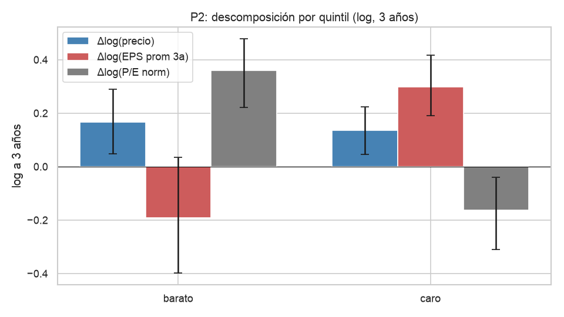
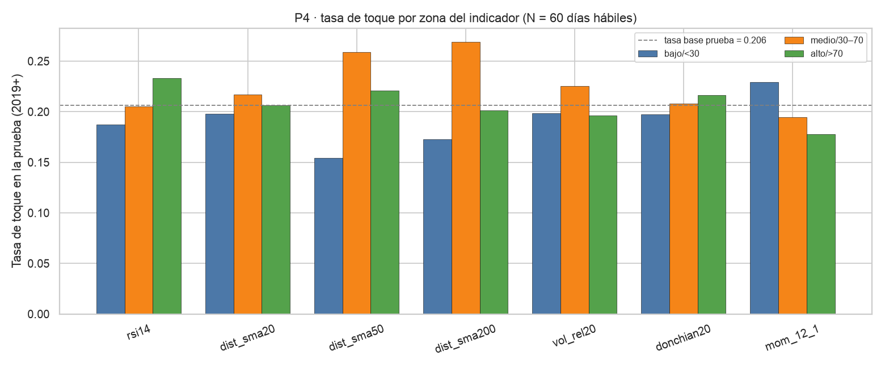

## 1. Problema

- **Inversor value colombiano** que compra acciones de EE.UU.: *screener*, fundamentales y gráfico en pantallas separadas; riesgo "a ojo"; sin registro de decisiones.
- Evidencia cualitativa (un participante + autor; muestra no representativa): **2 a 15 cambios de pantalla por activo**, **2 a 3 horas** por reporte trimestral.
- Contexto: Mercado Global Colombiano **+134 %** 2024→2025 (BVC); +87 % inversionistas desde 2023 (SFC).
- KPI: tiempo < 5 min, 1 pantalla, latencia ≤ 1 día, 100 % decisiones registradas.

## 2. Producto: seis niveles, tres lecturas

- **6 niveles** definidos por el usuario (3 de entrada, 3 de salida), en precio y en múltiplo.
- **3 lecturas** por nivel: fundamental (percentiles del P/E normalizado), técnica (SVM, N = 60 días), probabilística (simulación por bloques de la acción y del XLP).
- **Panel de riesgo** descriptivo: volatilidad, percentil 5, caída máxima, caídas fuertes, dependencia del sector.
- **Alcance de la entrega 1**: industria piloto consumo defensivo (21 empresas + SPY + XLP; KHC excluida).

## 3. Mockup (v2)

{width=72%}

## 3b. Feedback del inversor y respuesta en el mockup v2

- Validación 2026-10-18: sesión asíncrona por mensajería con un inversor; no respondió el formulario y entregó feedback libre.
- **Aceptado en v2 (H1 definiciones, H2 columnas separadas y notas aparte, H3 columna % vs. precio actual):** franja "Cómo leer esta pantalla" con 8 definiciones de una línea (incluye SVM); P/E y P/B en columnas separadas; columna "% vs. precio actual"; panel de riesgo con 5 filas espaciadas; marca descriptiva del precio actual sin veredicto.
- **No se adopta (H4):** el "veredicto" que pidió el participante choca con RN1 y con la regla de no recomendar.
- **Aplazado al punto 7 (H5):** prototipo navegable con más usuarios y medición de los KPI 1, 2 y 5 (sin línea base en esta sesión).
- Técnica (SVM, "se entrena en la entrega 2"): **21 / 42 / 71 %** frente a línea base **16 / 35 / 66 %**. Probabilística: **81 / 62 / 37 %**.

## 4. Ética y regulación

- **Ley 964 de 2005 y Decreto 2555 de 2010**: el producto no recomienda compra ni venta y no perfila al usuario; leyenda del art. 2.40.1.1.3 en cada pantalla.
- **Habeas Data (Ley 1581 de 2012)**: en la validación asíncrona del 2026-10-18 el participante participó de forma voluntaria y no se recogieron datos personales ni su nombre; el guion prevé consentimiento previo e informado bajo código para las sesiones moderadas futuras (ver `docs/entrega_1/03_etica_legal.md` §3.2).
- **Transparencia**: SVM lineal con coeficientes legibles; probabilidad junto a su línea base y su desempeño histórico.
- **Sin look-ahead ni data snooping**: fecha `filed`, ventana expansiva, 15 pruebas declaradas antes, Bonferroni en P4.

## 5. Enfoque analítico (6 preguntas, 1 hipótesis cada una)

**Plantilla por hipótesis:** umbral → H0/H1 → IC95 por bootstrap → decisión.

\footnotesize

| Preg. | Pregunta | Decide en la herramienta |
|---|---|---|
| P1 | ¿Caídas semanales fuertes > normal? | Panel de riesgo: "frecuencia de caídas fuertes" |
| P2 | ¿Barato sube P/E norm. > caro a 3 años? | Lectura fundam.: percentil P/E norm. + adv. deterioro |
| P3 | ¿Barato gana al XLP a 3 años? | Exceso sobre XLP **no entra como señal** |
| P4 | ¿Indicador técnico mejora, de forma lineal, la AUC del modelo A de magnitud? | Lectura técnica: SVM solo de magnitud; SVM RBF en entrega 2 |
| P5 | ¿XLP agrega ΔR² al SPY? | Panel de riesgo + simulación acción + XLP |
| P6 | ¿La turbulencia se agrupa? | Lectura probab.: simulación por bloques, k·σ252 |

\normalsize

## 5b. Qué mide P1 y qué es el P/E normalizado

- **Caída semanal fuerte (P1):** semana en que la acción cae más de 2 veces su volatilidad semanal del último año (`z < −2`). Con retornos normales y σ conocida pasaría en el 2,3 % de las semanas (≈ 1 de cada 44, ≈ 1,2/año); con σ estimada, la tasa comparable calibrada por simulación es ≈ 2,55 % (≈ 1 de cada 39, ≈ 1,3/año). El umbral de 3,83 % (≈ 1 de cada 26, ≈ 2/año) agotaría más seguido el presupuesto de pérdida.
- **P/E normalizado:** precio ÷ **EPS promedio de 3 años** (utilidad neta de 12 trimestres ÷ 3 ÷ acciones). Evita que un solo año excepcional haga parecer barata o cara una acción.

## 6. Datos (tres fuentes gratuitas, instantánea fechada)

- **yfinance**: 21 344 filas semanales × 23 tickers desde 2009; precios ajustados y sin ajustar por dividendos.
- **SEC EDGAR**: hechos XBRL de los 10-K y 10-Q con fecha `filed`; el P/E usa el EPS TTM reconstruido con los 10-Q.
- **Damodaran**: múltiplos y márgenes por industria.
- Calidad en nb02: 9 dimensiones y 5 niveles; 0 nulos en precios ajustados, 0 duplicados; TTM válido en 1.308 de 1.434 trimestres (91,2 %).

## 7. EDA: resultados por hipótesis

| Preg. | Estimado · IC95 · Decisión |
|---|---|
| P1 | 3,08 % (≈ 1,6/año) · [2,46; 3,92] % (≈ 1,3–2,0/año) · **no se rechaza H0**, no accionable |
| P2 | +0,153 · [+0,091; +0,221] · **se rechaza H0**, accionable |
| P3 | +0,006 · [−0,032; +0,049] · **no se rechaza H0**, no accionable |
| P4 | 7 indicadores con IC que cruzan 0 · **no se rechaza H0** (×7) |
| P5 | ΔR² 0,225 · [+0,175; +0,291] · **se rechaza H0**, accionable (confirmatoria) |
| P6 d. | P(T\|T) 0,305 · [0,275; 0,340] · **se rechaza H0**, magnitud incierta |

## 8. P2: barato sube más, trampa de valor afirmada como asociación

{width=70%}

Barato − caro: **+0,153 anualizado en log** (IC95 por empresa [+0,091; +0,221]). La **diferencia barato − caro** reparte +0,46 (3 años) en Δlog(precio) +0,014 (IC95 [−0,115; +0,155], cruza 0) y Δlog(EPS prom 3a) −0,444 (IC95 [−0,693; −0,210], excluye 0): **trampa de valor afirmada como asociación**. nb04 §2.7–§2.8.

## 9. P4: ningún indicador aporta, de forma lineal, sobre el modelo de magnitud

{width=65%}

ΔAUC frente al modelo A (AUC **0,577** en la submuestra; base del SVM 0,591 sobre todas las filas): 7 IC95 (Bonferroni ≈ 99,3 %) cruzan 0. P4 mide **aporte lineal**; §5.5 sugiere un patrón no lineal en `dist_sma50` y `dist_sma200`. Consecuencia: `variables_svm = {|r_t|, σ20/σ252, σ252}`; la entrega 2 prueba el SVM RBF. nb04 §5.3 y §5.5.

## 10. Conclusiones y próximos pasos

- **Insights**: niveles en k·σ252, N = 60; simulación por bloques de la acción + XLP; exceso sobre XLP **no entra como señal**; marca "industria no validada" fuera del piloto.
- **Limitaciones**: una industria piloto; supervivencia; 3 años (no 5–10); P5 confirmatoria; P4 con fuga de selección y solo mide aporte lineal; validación del mockup con un solo inversor, asíncrona, y KPI 1, 2 y 5 sin línea base.
- **Próximos pasos**: entrenar el SVM (lineal y RBF para captar aportes no lineales que P4 no detecta) con corte cronológico, simulación por bloques, **prototipo navegable con más usuarios** y medición de KPI, segunda industria.
- Repositorio: <https://github.com/louis97/asistente-financiero>. Video: https://youtu.be/NGZdh3TD46E.
