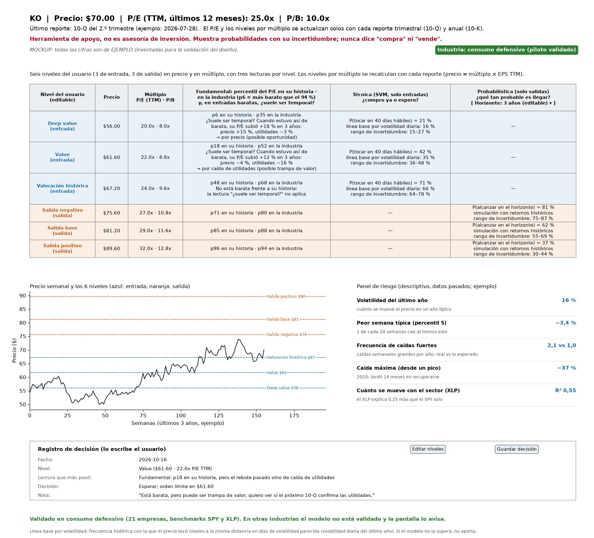
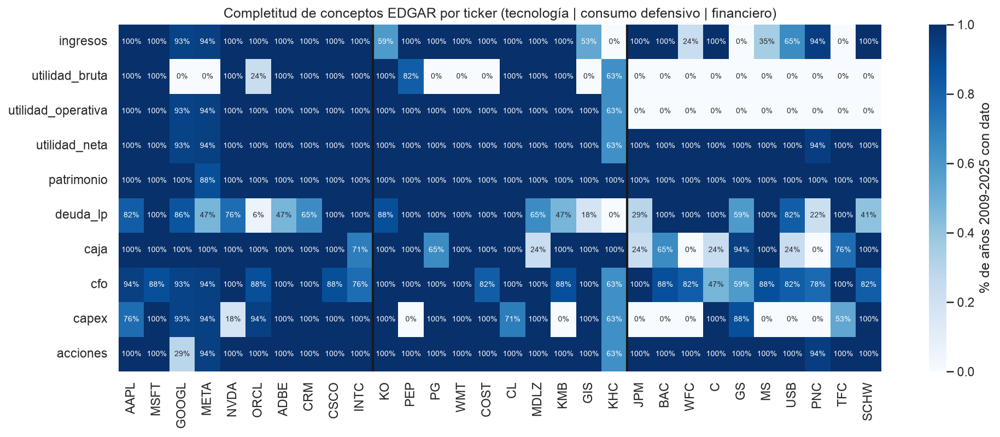
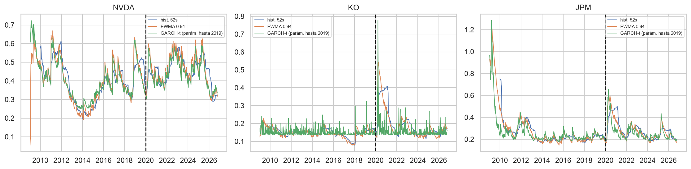
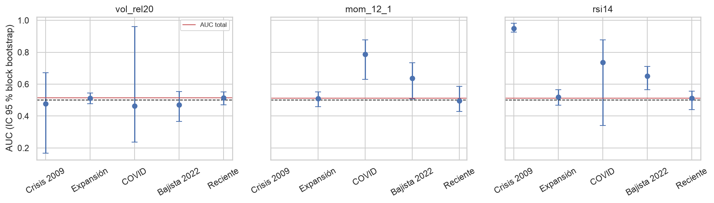
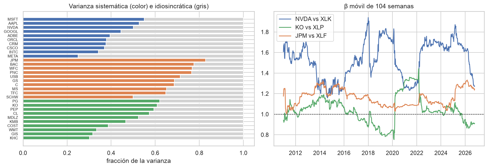

**Repositorio:** <https://github.com/louis97/asistente-financiero/tree/entrega-1> · **Video:** (pendiente)

## 1. Problema y negocio

El inversor value colombiano que compra acciones de EE.UU. actúa como enrutador manual de datos: usa un screener, otra pantalla para fundamentales y otra para el gráfico, y no tiene dónde anotar sus decisiones. Con la evidencia cualitativa de una entrevista y un formulario (un participante más el autor; evidencia exploratoria, no representativa): **de 2 a 15 cambios de pantalla por activo**, **2 a 3 horas** para actualizar el análisis tras cada reporte trimestral y riesgo medido "a ojo". El contexto crece: el volumen del Mercado Global Colombiano pasó de $1,60 a $3,75 billones entre 2024 y 2025 (+134 %, BVC). Objetivo: una vista única con niveles de compra y venta, y probabilidades explicables. KPIs: tiempo por activo < 5 min, 1 cambio de pantalla, latencia tras reporte ≤ 1 día, 100 % de decisiones registradas.

Detalle: [01_negocio.md](https://github.com/louis97/asistente-financiero/blob/entrega-1/docs/entrega_1/01_negocio.md)

## 2. Ideación y mockup

El producto entrega seis niveles definidos por el usuario (tres de entrada, tres de salida), cada uno en precio y en múltiplo, con tres lecturas: fundamental (percentil en la historia y la industria), técnica (probabilidad de un SVM frente a su línea base GBM) y probabilística (Monte Carlo con y sin el factor del sector), más un panel de riesgo (volatilidad, VaR/ES, beta, drawdown, Merton). Los niveles por múltiplo se recalculan cuando EDGAR publica un reporte (precio = múltiplo × EPS). El prototipo usa valores ilustrativos. **La validación con el stakeholder está pendiente**: el guion está listo y el registro se completará tras la sesión; no se reportan resultados de validación.

{width=88%}

Detalle: [02_ideacion.md](https://github.com/louis97/asistente-financiero/blob/entrega-1/docs/entrega_1/02_ideacion.md)

## 3. Aspectos éticos y legales

Los riesgos altos son tres. **Regulación de la asesoría** (Ley 964 de 2005): el producto no recomienda "compra" ni "venta", los niveles los define el usuario y cada pantalla dice que no es asesoría. **Transparencia**: SVM lineal con coeficientes legibles y probabilidad siempre junto a su línea base y su error histórico. **Look-ahead y data snooping**: fundamentales con fecha `filed`, ventana expansiva, purga y embargo. Además: anonimización del participante (Ley 1581 de 2012), términos de uso de yfinance, EDGAR y Damodaran, y sesgo de supervivencia de 30 emisores vigentes.

Detalle: [03_etica_legal.md](https://github.com/louis97/asistente-financiero/blob/entrega-1/docs/entrega_1/03_etica_legal.md)

## 4. Enfoque analítico

Tres preguntas de negocio (¿es razonable el nivel?, ¿compro ya o espero?, ¿qué tan probable es el objetivo?) se traducen en hipótesis con H0 y H1 que se pueden refutar: técnicas (HT0 caminata aleatoria, HT1 SVM frente a GBM, HT2 señal de indicadores), fundamentales (HF1 y HF2 reversión de múltiplos) y probabilísticas (HP0 colas pesadas, HP3 efecto del sector). La etiqueta es una **triple barrera solo-largo** (±k·σ, horizonte de N semanas; en el EDA se eligió k = 1, N = 12). Validación **walk-forward con purga y embargo**, con cuatro líneas base obligatorias (GBM, clase mayoritaria, regresión logística, momentum 12-1) y reglas de decisión fijadas de antemano: una hipótesis solo se declara apoyada si el IC bootstrap excluye el valor nulo. Todo es asociativo, no causal.

Detalle: [04_enfoque_analitico.md](https://github.com/louis97/asistente-financiero/blob/entrega-1/docs/entrega_1/04_enfoque_analitico.md)

## 5. Recolección y calidad de datos

Tres fuentes gratuitas: yfinance (precios semanales y mensuales desde 2009), SEC EDGAR (hechos XBRL con fecha `filed`) y Damodaran (múltiplos por industria). Universo: 30 acciones grandes de EE.UU. y 4 ETF (SPY, XLK, XLP, XLF), con 27 326 filas en el panel semanal. Calidad: precios sin nulos, duplicados ni semanas faltantes; 73 saltos > 5σ que son movimientos reales. La utilidad bruta está presente en solo 14 de 30 emisores (ausente en 16) y las financieras no tienen utilidad operativa. Las cifras de EDGAR coinciden en 6 de 6 con el 10-K de AAPL, KO y JPM.

{width=62%}

Detalle: [05_diccionario_datos.md](https://github.com/louis97/asistente-financiero/blob/entrega-1/docs/entrega_1/05_diccionario_datos.md) · [nb 02](https://github.com/louis97/asistente-financiero/blob/entrega-1/notebooks/02_calidad.ipynb)

## 6. Análisis exploratorio (EDA)

**Volatilidad y colas.** La volatilidad se agrupa y las colas son pesadas: curtosis en exceso mediana 4.63, ν mediano 4.15 (ν < 10 en 34 de 34 series); GARCH(1,1)-t supera a la volatilidad constante fuera de muestra en 28 de 34 series. Un GBM normal no describe el riesgo (HP0 apoyada).

{width=62%}

**Dirección del precio.** ADF no rechaza la raíz unitaria en 33 de 34 log-precios y |ρ lag 1| mediana es 0.068 (HT0 apoyada). Con k = 1, N = 12, un GBM con μ = 0 sobreestima la clase 1 en 9.5 pp (0.178 observada frente a 0.274) y, con deriva pasada, la sobreestima en 0.8 pp.

**Indicadores técnicos.** La señal es débil e inestable: AUC por indicador de 0.496 a 0.514, ningún IC por bloques excluye 0.5. Por régimen sube a 0.64–0.79 solo en COVID y 2022, eventos únicos (HT2 no concluyente, HT3 no apoyada).

{width=62%}

**Sector.** El R² mediano del modelo de índice único con el ETF sectorial es 0.525 (financieras 0.700, tecnología 0.387); las industrias se agrupan solas (ARI 0.898) (HP3 apoyada con matices).

{width=62%}

**Múltiplos y VaR.** Solo 7 de 29 tickers muestran reversión del P/E o P/B (HF1 no apoyada) y 10 de 29 con el múltiplo relativo (HF2 parcial). El VaR 95 % fuera de muestra tiene 7.49 % de excepciones con GARCH-t y 6.78 % con el histórico, frente al 5 % esperado (HP1 parcial).

Detalle: [03_eda_series](https://github.com/louis97/asistente-financiero/blob/entrega-1/notebooks/03_eda_series.ipynb) · [04_eda_relaciones](https://github.com/louis97/asistente-financiero/blob/entrega-1/notebooks/04_eda_relaciones.ipynb) · [07_conclusiones.md](https://github.com/louis97/asistente-financiero/blob/entrega-1/docs/entrega_1/07_conclusiones.md)

## 7. Conclusiones e insights

El EDA no muestra que los indicadores técnicos, por sí solos, separen las clases; la probabilidad de la etiqueta depende de σ (de 20.6 % en el decil 1 a 7.8 % en el decil 10) y del régimen. Decisiones de diseño: etiqueta k = 1, N = 12; simulación con GARCH-t e innovaciones t, no GBM normal; línea base GBM con deriva ≤ t; múltiplos solo como contexto; VaR 99 % histórico con advertencia. **Limitaciones**: muestra desde 2009, pocos eventos de régimen, sesgo de supervivencia y fundamentales incompletos. **Próximas acciones**: entrenar el SVM con walk-forward (HT1 queda preparada, no probada; se espera una mejora pequeña o nula), añadir rasgos de régimen calculados hacia atrás, construir el Monte Carlo y validar el mockup con el stakeholder.

Detalle: [07_conclusiones.md](https://github.com/louis97/asistente-financiero/blob/entrega-1/docs/entrega_1/07_conclusiones.md)
